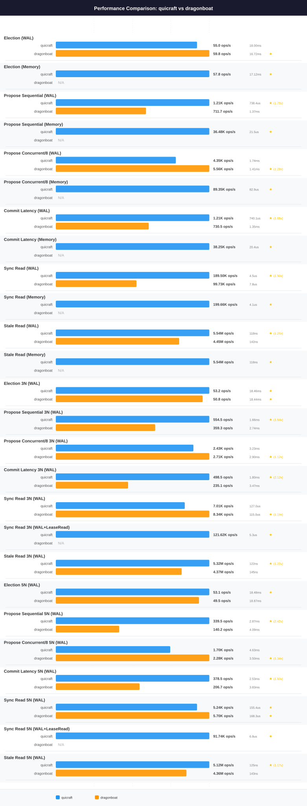

# QuicRaft vs Dragonboat — `ci-node-2` profile

> **Generated file.** `perfcompare generate` deletes and rewrites this
> document from `results/*.json`; edits made here are lost on the next
> run. Written analysis belongs in [analysis.md](analysis.md), which the
> generator never touches.

| | |
|---|---|
| Profile | `ci-node-2` |
| Hardware | Intel(R) Xeon(R) Gold 6258R CPU @ 2.70GHz, 2 socket(s), 112 threads, 372.2 GiB, Ubuntu 26.04.1 LTS (Resolute Raccoon), kernel 7.0.0-31-generic |
| Specs captured | 2026-09-14T02:02:53Z |
| QuicRaft run | 2026-09-14T02:03:22Z (version 0.0.0) |
| Dragonboat run | 2026-09-14T03:28:34Z (version v4.0.0) |
| Document generated | 2026-09-14 03:45:09 UTC |

Numbers below were measured on this profile's machine only. Nothing here is
comparable with a number from another profile; do not compute a ratio across two.

## Coverage on this profile

This document compares quicraft against dragonboat. Systems measured on `ci-node-2`: quicraft, etcd, dragonboat, openraft.

Every known system has results on this profile.

## Machine

Captured on the target at run time by `capture-env.sh`; never hand-edited.

| Component | Value |
|---|---|
| Profile | ci-node-2 |
| Hostname | ci-node-2 |
| CPU | Intel(R) Xeon(R) Gold 6258R CPU @ 2.70GHz |
| Sockets | 2 |
| Physical cores | 56 |
| Threads | 112 |
| NUMA nodes | 2 |
| Memory | 372.2 GiB |
| OS | Ubuntu |
| OS version | 26.04.1 LTS (Resolute Raccoon) |
| Kernel | 7.0.0-31-generic |
| Docker | 29.1.3 |
| Go | **not captured** |
| Specs captured | 2026-09-14T02:02:53Z |

The capture could not obtain: Go.

## Charts

## Head-to-head

| Scenario | QuicRaft | Dragonboat | Winner | Ratio |
|---|---|---|---|---|
| Election (WAL) | 51.8 ops/s, P50 20.74ms, P95 26.19ms, P99 27.09ms | 50.7 ops/s, P50 18.73ms, P95 25.67ms, P99 30.86ms | quicraft | 1.02x |
| Propose Sequential (WAL) | 1.30K ops/s, P50 699.6us, P95 1.21ms, P99 1.40ms | 1.23K ops/s, P50 757.5us, P95 1.02ms, P99 1.42ms | quicraft | 1.06x |
| Propose Concurrent/8 (WAL) | 5.03K ops/s, P50 1.50ms, P95 2.07ms, P99 2.22ms | 5.67K ops/s, P50 1.34ms, P95 1.71ms, P99 4.00ms | dragonboat | 1.13x |
| Commit Latency (WAL) | 1.28K ops/s, P50 708.6us, P95 1.26ms, P99 1.50ms | 1.24K ops/s, P50 750.7us, P95 1.00ms, P99 1.74ms | quicraft | 1.03x |
| Sync Read (WAL) | 242.79K ops/s, P50 3.3us, P95 8.2us, P99 11.6us | 123.62K ops/s, P50 6.3us, P95 16.8us, P99 26.7us | quicraft | 1.96x |
| Stale Read (WAL) | 5.06M ops/s, P50 126ns, P95 149ns, P99 284ns | 4.68M ops/s, P50 142ns, P95 237ns, P99 454ns | quicraft | 1.08x |
| Election 3N (WAL) | 52.1 ops/s, P50 17.72ms, P95 23.41ms, P99 32.53ms | 47.0 ops/s, P50 20.24ms, P95 29.38ms, P99 42.02ms | quicraft | 1.11x |
| Propose Sequential 3N (WAL) | 454.3 ops/s, P50 2.01ms, P95 3.76ms, P99 4.28ms | 221.8 ops/s, P50 2.40ms, P95 2.97ms, P99 4.98ms | quicraft | 2.05x |
| Propose Concurrent/8 3N (WAL) | 2.27K ops/s, P50 3.39ms, P95 4.87ms, P99 5.58ms | 1.87K ops/s, P50 2.61ms, P95 3.28ms, P99 4.95ms | quicraft | 1.21x |
| Commit Latency 3N (WAL) | 412.8 ops/s, P50 2.20ms, P95 3.88ms, P99 4.32ms | 292.6 ops/s, P50 2.34ms, P95 2.80ms, P99 3.48ms | quicraft | 1.41x |
| Sync Read 3N (WAL) | 6.76K ops/s, P50 130.1us, P95 247.4us, P99 360.5us | 8.18K ops/s, P50 112.6us, P95 174.9us, P99 267.9us | dragonboat | 1.21x |
| Stale Read 3N (WAL) | 5.27M ops/s, P50 124ns, P95 150ns, P99 451ns | 4.72M ops/s, P50 143ns, P95 165ns, P99 428ns | quicraft | 1.12x |
| Election 5N (WAL) | 51.9 ops/s, P50 18.88ms, P95 24.12ms, P99 33.43ms | 45.9 ops/s, P50 20.49ms, P95 28.43ms, P99 51.88ms | quicraft | 1.13x |
| Propose Sequential 5N (WAL) | 357.4 ops/s, P50 2.71ms, P95 4.23ms, P99 5.03ms | 237.6 ops/s, P50 2.93ms, P95 3.53ms, P99 4.43ms | quicraft | 1.50x |
| Propose Concurrent/8 5N (WAL) | 1.53K ops/s, P50 5.11ms, P95 7.62ms, P99 9.12ms | 2.00K ops/s, P50 2.96ms, P95 3.63ms, P99 5.11ms | dragonboat | 1.31x |
| Commit Latency 5N (WAL) | 278.2 ops/s, P50 3.46ms, P95 4.97ms, P99 5.73ms | 93.8 ops/s, P50 2.88ms, P95 3.54ms, P99 5.09ms | quicraft | 2.97x |
| Sync Read 5N (WAL) | 5.14K ops/s, P50 157.6us, P95 370.0us, P99 467.5us | 1.95K ops/s, P50 180.4us, P95 549.0us, P99 642.5us | quicraft | 2.63x |
| Stale Read 5N (WAL) | 5.04M ops/s, P50 127ns, P95 171ns, P99 471ns | 4.58M ops/s, P50 143ns, P95 184ns, P99 531ns | quicraft | 1.10x |

**Score: QuicRaft 15, Dragonboat 3, across 18 head-to-head scenarios.**

## Measured for QuicRaft only

The Dragonboat harness implements no equivalent scenario.

| Scenario | Throughput | Latency |
|---|---|---|
| Election (Memory) | 52.5 ops/s | P50 20.34ms, P95 26.00ms, P99 26.46ms |
| Propose Sequential (Memory) | 55.31K ops/s | P50 14.5us, P95 38.0us, P99 50.9us |
| Propose Concurrent/8 (Memory) | 112.82K ops/s | P50 66.3us, P95 106.3us, P99 130.6us |
| Commit Latency (Memory) | 45.04K ops/s | P50 17.4us, P95 48.1us, P99 67.8us |
| Sync Read (Memory) | 255.36K ops/s | P50 3.1us, P95 7.8us, P99 11.6us |
| Stale Read (Memory) | 5.19M ops/s | P50 124ns, P95 149ns, P99 353ns |
| Sync Read 3N (WAL+LeaseRead) | 122.89K ops/s | P50 5.1us, P95 11.8us, P99 26.3us |
| Sync Read 5N (WAL+LeaseRead) | 94.84K ops/s | P50 6.6us, P95 15.9us, P99 37.9us |

## Run configuration

| Parameter | QuicRaft | Dragonboat |
|---|---|---|
| Payload | 128 bytes | 128 bytes |
| Concurrent goroutines | 8 | 8 |
| TLS | yes | yes |
| RTT | 1ms | 1ms |
| Election RTT | 10 ticks | 10 ticks |
| Heartbeat RTT | 1 ticks | 1 ticks |

Written analysis of these numbers lives in [analysis.md](analysis.md).
