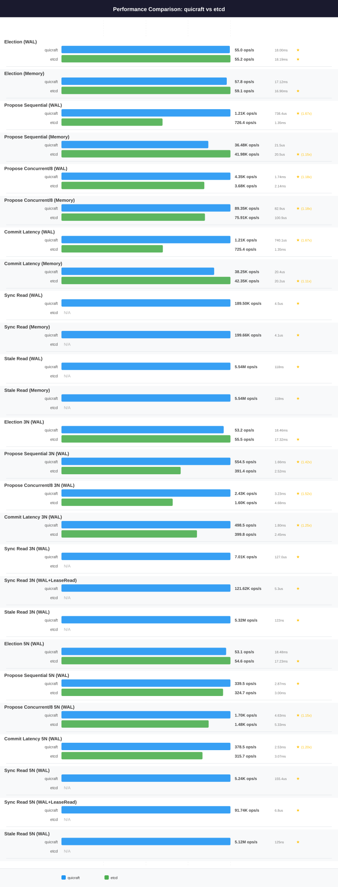

# QuicRaft vs Etcd — `ci-node-2` profile

> **Generated file.** `perfcompare generate` deletes and rewrites this
> document from `results/*.json`; edits made here are lost on the next
> run. Written analysis belongs in [analysis.md](analysis.md), which the
> generator never touches.

| | |
|---|---|
| Profile | `ci-node-2` |
| Hardware | Intel(R) Xeon(R) Gold 6258R CPU @ 2.70GHz, 2 socket(s), 112 threads, 372.2 GiB, Ubuntu 26.04.1 LTS (Resolute Raccoon), kernel 7.0.0-31-generic |
| Specs captured | 2026-09-14T02:02:53Z |
| QuicRaft run | 2026-09-14T02:03:22Z (version 0.0.0) |
| Etcd run | 2026-09-14T02:25:36Z (version v3.7.0) |
| Document generated | 2026-09-14 03:45:09 UTC |

Numbers below were measured on this profile's machine only. Nothing here is
comparable with a number from another profile; do not compute a ratio across two.

## Coverage on this profile

This document compares quicraft against etcd. Systems measured on `ci-node-2`: quicraft, etcd, dragonboat, openraft.

Every known system has results on this profile.

## Machine

Captured on the target at run time by `capture-env.sh`; never hand-edited.

| Component | Value |
|---|---|
| Profile | ci-node-2 |
| Hostname | ci-node-2 |
| CPU | Intel(R) Xeon(R) Gold 6258R CPU @ 2.70GHz |
| Sockets | 2 |
| Physical cores | 56 |
| Threads | 112 |
| NUMA nodes | 2 |
| Memory | 372.2 GiB |
| OS | Ubuntu |
| OS version | 26.04.1 LTS (Resolute Raccoon) |
| Kernel | 7.0.0-31-generic |
| Docker | 29.1.3 |
| Go | **not captured** |
| Specs captured | 2026-09-14T02:02:53Z |

The capture could not obtain: Go.

## Charts

## Head-to-head

| Scenario | QuicRaft | Etcd | Winner | Ratio |
|---|---|---|---|---|
| Election (WAL) | 51.8 ops/s, P50 20.74ms, P95 26.19ms, P99 27.09ms | 58.0 ops/s, P50 17.36ms, P95 22.28ms, P99 23.76ms | etcd | 1.12x |
| Election (Memory) | 52.5 ops/s, P50 20.34ms, P95 26.00ms, P99 26.46ms | 60.9 ops/s, P50 16.44ms, P95 21.33ms, P99 22.51ms | etcd | 1.16x |
| Propose Sequential (WAL) | 1.30K ops/s, P50 699.6us, P95 1.21ms, P99 1.40ms | 657.3 ops/s, P50 1.49ms, P95 1.76ms, P99 2.39ms | quicraft | 1.98x |
| Propose Sequential (Memory) | 55.31K ops/s, P50 14.5us, P95 38.0us, P99 50.9us | 3.56K ops/s, P50 67.8us, P95 1.26ms, P99 1.29ms | quicraft | 15.52x |
| Propose Concurrent/8 (WAL) | 5.03K ops/s, P50 1.50ms, P95 2.07ms, P99 2.22ms | 3.67K ops/s, P50 2.20ms, P95 2.55ms, P99 2.82ms | quicraft | 1.37x |
| Propose Concurrent/8 (Memory) | 112.82K ops/s, P50 66.3us, P95 106.3us, P99 130.6us | 44.38K ops/s, P50 136.8us, P95 431.8us, P99 1.13ms | quicraft | 2.54x |
| Commit Latency (WAL) | 1.28K ops/s, P50 708.6us, P95 1.26ms, P99 1.50ms | 663.5 ops/s, P50 1.48ms, P95 1.73ms, P99 2.32ms | quicraft | 1.93x |
| Commit Latency (Memory) | 45.04K ops/s, P50 17.4us, P95 48.1us, P99 67.8us | 2.30K ops/s, P50 64.0us, P95 1.15ms, P99 1.23ms | quicraft | 19.62x |
| Election 3N (WAL) | 52.1 ops/s, P50 17.72ms, P95 23.41ms, P99 32.53ms | 11.4 ops/s, P50 85.54ms, P95 110.23ms, P99 129.48ms | quicraft | 4.59x |
| Propose Sequential 3N (WAL) | 454.3 ops/s, P50 2.01ms, P95 3.76ms, P99 4.28ms | 365.5 ops/s, P50 2.67ms, P95 3.28ms, P99 3.76ms | quicraft | 1.24x |
| Propose Concurrent/8 3N (WAL) | 2.27K ops/s, P50 3.39ms, P95 4.87ms, P99 5.58ms | 1.43K ops/s, P50 5.51ms, P95 6.96ms, P99 8.71ms | quicraft | 1.59x |
| Commit Latency 3N (WAL) | 412.8 ops/s, P50 2.20ms, P95 3.88ms, P99 4.32ms | 332.5 ops/s, P50 2.91ms, P95 3.78ms, P99 4.37ms | quicraft | 1.24x |
| Election 5N (WAL) | 51.9 ops/s, P50 18.88ms, P95 24.12ms, P99 33.43ms | 6.2 ops/s, P50 156.99ms, P95 195.91ms, P99 211.06ms | quicraft | 8.35x |
| Propose Sequential 5N (WAL) | 357.4 ops/s, P50 2.71ms, P95 4.23ms, P99 5.03ms | 278.5 ops/s, P50 3.51ms, P95 4.44ms, P99 5.23ms | quicraft | 1.28x |
| Propose Concurrent/8 5N (WAL) | 1.53K ops/s, P50 5.11ms, P95 7.62ms, P99 9.12ms | 1.20K ops/s, P50 6.54ms, P95 8.43ms, P99 10.25ms | quicraft | 1.27x |
| Commit Latency 5N (WAL) | 278.2 ops/s, P50 3.46ms, P95 4.97ms, P99 5.73ms | 288.3 ops/s, P50 3.38ms, P95 4.33ms, P99 4.89ms | etcd | 1.04x |

**Score: QuicRaft 13, Etcd 3, across 16 head-to-head scenarios.**

## Measured for QuicRaft only

The Etcd harness implements no equivalent scenario.

| Scenario | Throughput | Latency |
|---|---|---|
| Sync Read (WAL) | 242.79K ops/s | P50 3.3us, P95 8.2us, P99 11.6us |
| Sync Read (Memory) | 255.36K ops/s | P50 3.1us, P95 7.8us, P99 11.6us |
| Stale Read (WAL) | 5.06M ops/s | P50 126ns, P95 149ns, P99 284ns |
| Stale Read (Memory) | 5.19M ops/s | P50 124ns, P95 149ns, P99 353ns |
| Sync Read 3N (WAL) | 6.76K ops/s | P50 130.1us, P95 247.4us, P99 360.5us |
| Sync Read 3N (WAL+LeaseRead) | 122.89K ops/s | P50 5.1us, P95 11.8us, P99 26.3us |
| Stale Read 3N (WAL) | 5.27M ops/s | P50 124ns, P95 150ns, P99 451ns |
| Sync Read 5N (WAL) | 5.14K ops/s | P50 157.6us, P95 370.0us, P99 467.5us |
| Sync Read 5N (WAL+LeaseRead) | 94.84K ops/s | P50 6.6us, P95 15.9us, P99 37.9us |
| Stale Read 5N (WAL) | 5.04M ops/s | P50 127ns, P95 171ns, P99 471ns |

## Run configuration

| Parameter | QuicRaft | Etcd |
|---|---|---|
| Payload | 128 bytes | 128 bytes |
| Concurrent goroutines | 8 | 8 |
| TLS | yes | no |
| RTT | 1ms | 1ms |
| Election RTT | 10 ticks | 10 ticks |
| Heartbeat RTT | 1 ticks | 1 ticks |

Written analysis of these numbers lives in [analysis.md](analysis.md).
