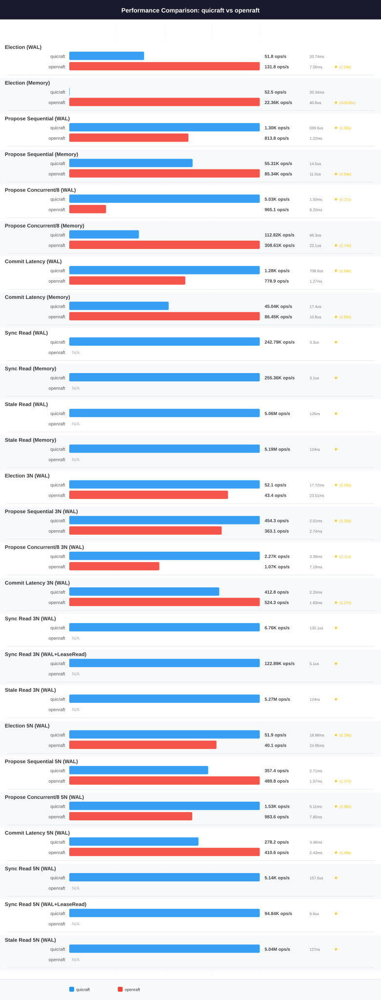

# QuicRaft vs Openraft — `ci-node-2` profile

> **Generated file.** `perfcompare generate` deletes and rewrites this
> document from `results/*.json`; edits made here are lost on the next
> run. Written analysis belongs in [analysis.md](analysis.md), which the
> generator never touches.

| | |
|---|---|
| Profile | `ci-node-2` |
| Hardware | Intel(R) Xeon(R) Gold 6258R CPU @ 2.70GHz, 2 socket(s), 112 threads, 372.2 GiB, Ubuntu 26.04.1 LTS (Resolute Raccoon), kernel 7.0.0-31-generic |
| Specs captured | 2026-10-02T22:44:29Z |
| QuicRaft run | 2026-10-02T22:44:47Z (version 0.16.0) |
| Openraft run | 2026-10-02T23:48:05.594665658+00:00 (version v0.9) |
| Document generated | 2026-10-02 23:48:09 UTC |

Numbers below were measured on this profile's machine only. Nothing here is
comparable with a number from another profile; do not compute a ratio across two.

## Coverage on this profile

This document compares quicraft against openraft. Systems measured on `ci-node-2`: quicraft, etcd, dragonboat, openraft.

Every known system has results on this profile.

## Machine

Captured on the target at run time by `capture-env.sh`; never hand-edited.

| Component | Value |
|---|---|
| Profile | ci-node-2 |
| Hostname | ci-node-2 |
| CPU | Intel(R) Xeon(R) Gold 6258R CPU @ 2.70GHz |
| Sockets | 2 |
| Physical cores | 56 |
| Threads | 112 |
| NUMA nodes | 2 |
| Memory | 372.2 GiB |
| OS | Ubuntu |
| OS version | 26.04.1 LTS (Resolute Raccoon) |
| Kernel | 7.0.0-31-generic |
| Docker | 29.1.3 |
| Go | **not captured** |
| Specs captured | 2026-10-02T22:44:29Z |

The capture could not obtain: Go.

## Charts

## Head-to-head

| Scenario | QuicRaft | Openraft | Winner | Ratio |
|---|---|---|---|---|
| Election (WAL) | 52.3 ops/s, P50 19.06ms, P95 26.22ms, P99 27.10ms | 151.3 ops/s, P50 6.58ms, P95 7.20ms, P99 8.03ms | openraft | 2.89x |
| Election (Memory) | 53.8 ops/s, P50 17.61ms, P95 25.60ms, P99 26.64ms | 24.34K ops/s, P50 38.4us, P95 55.6us, P99 79.4us | openraft | 452.56x |
| Propose Sequential (WAL) | 1.24K ops/s, P50 730.3us, P95 1.30ms, P99 1.57ms | 1.37K ops/s, P50 691.1us, P95 944.8us, P99 1.09ms | openraft | 1.11x |
| Propose Sequential (Memory) | 46.22K ops/s, P50 17.1us, P95 47.0us, P99 62.9us | 83.24K ops/s, P50 11.1us, P95 16.8us, P99 21.7us | openraft | 1.80x |
| Propose Concurrent/8 (WAL) | 4.60K ops/s, P50 1.67ms, P95 2.31ms, P99 2.98ms | 1.44K ops/s, P50 5.48ms, P95 6.44ms, P99 7.32ms | quicraft | 3.19x |
| Propose Concurrent/8 (Memory) | 97.92K ops/s, P50 75.8us, P95 123.9us, P99 153.0us | 318.35K ops/s, P50 22.1us, P95 39.2us, P99 60.1us | openraft | 3.25x |
| Commit Latency (WAL) | 1.28K ops/s, P50 701.1us, P95 1.23ms, P99 1.55ms | 1.27K ops/s, P50 713.4us, P95 1.11ms, P99 1.37ms | quicraft | 1.01x |
| Commit Latency (Memory) | 49.94K ops/s, P50 14.9us, P95 46.2us, P99 66.9us | 64.79K ops/s, P50 12.5us, P95 21.6us, P99 43.3us | openraft | 1.30x |
| Election 3N (WAL) | 51.5 ops/s, P50 18.67ms, P95 24.64ms, P99 29.68ms | 46.8 ops/s, P50 21.26ms, P95 23.17ms, P99 25.95ms | quicraft | 1.10x |
| Propose Sequential 3N (WAL) | 474.6 ops/s, P50 1.93ms, P95 3.53ms, P99 4.60ms | 506.5 ops/s, P50 1.88ms, P95 2.61ms, P99 2.98ms | openraft | 1.07x |
| Propose Concurrent/8 3N (WAL) | 2.07K ops/s, P50 3.39ms, P95 5.45ms, P99 6.96ms | 1.10K ops/s, P50 6.98ms, P95 9.34ms, P99 11.06ms | quicraft | 1.88x |
| Commit Latency 3N (WAL) | 557.0 ops/s, P50 1.67ms, P95 2.63ms, P99 3.23ms | 457.3 ops/s, P50 2.08ms, P95 2.95ms, P99 3.27ms | quicraft | 1.22x |
| Election 5N (WAL) | 51.7 ops/s, P50 19.30ms, P95 24.37ms, P99 27.82ms | 38.9 ops/s, P50 25.65ms, P95 27.07ms, P99 29.17ms | quicraft | 1.33x |
| Propose Sequential 5N (WAL) | 378.0 ops/s, P50 2.49ms, P95 4.27ms, P99 5.73ms | 466.7 ops/s, P50 2.03ms, P95 2.77ms, P99 3.19ms | openraft | 1.23x |
| Propose Concurrent/8 5N (WAL) | 1.45K ops/s, P50 5.00ms, P95 7.68ms, P99 9.48ms | 977.6 ops/s, P50 7.93ms, P95 10.88ms, P99 12.37ms | quicraft | 1.49x |
| Commit Latency 5N (WAL) | 366.8 ops/s, P50 2.62ms, P95 4.16ms, P99 5.04ms | 470.4 ops/s, P50 2.04ms, P95 2.72ms, P99 3.17ms | openraft | 1.28x |

**Score: QuicRaft 7, Openraft 9, across 16 head-to-head scenarios.**

## Measured for QuicRaft only

The Openraft harness implements no equivalent scenario.

| Scenario | Throughput | Latency |
|---|---|---|
| Sync Read (WAL) | 224.45K ops/s | P50 3.4us, P95 9.8us, P99 14.0us |
| Sync Read (Memory) | 223.52K ops/s | P50 3.4us, P95 9.8us, P99 14.1us |
| Stale Read (WAL) | 5.08M ops/s | P50 122ns, P95 150ns, P99 311ns |
| Stale Read (Memory) | 4.77M ops/s | P50 132ns, P95 221ns, P99 330ns |
| Sync Read 3N (WAL) | 7.16K ops/s | P50 126.7us, P95 210.0us, P99 302.3us |
| Sync Read 3N (WAL+LeaseRead) | 146.60K ops/s | P50 4.2us, P95 10.9us, P99 20.2us |
| Stale Read 3N (WAL) | 4.63M ops/s | P50 133ns, P95 251ns, P99 412ns |
| Sync Read 5N (WAL) | 5.74K ops/s | P50 149.5us, P95 320.2us, P99 419.6us |
| Sync Read 5N (WAL+LeaseRead) | 122.82K ops/s | P50 4.9us, P95 13.3us, P99 28.3us |
| Stale Read 5N (WAL) | 4.48M ops/s | P50 134ns, P95 263ns, P99 448ns |

## Run configuration

| Parameter | QuicRaft | Openraft |
|---|---|---|
| Payload | 128 bytes | 128 bytes |
| Concurrent goroutines | 8 | 8 |
| TLS | yes | yes |
| RTT | 1ms | 1ms |
| Election RTT | 10 ticks | 10 ticks |
| Heartbeat RTT | 1 ticks | 1 ticks |

Written analysis of these numbers lives in [analysis.md](analysis.md).
