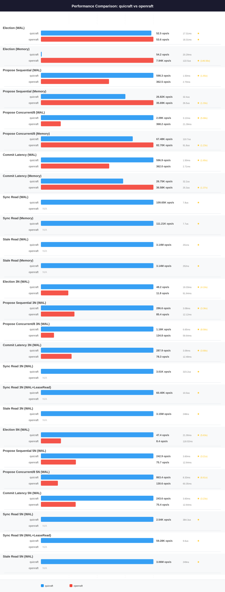

# QuicRaft vs Openraft — `omega` profile

> **Generated file.** `perfcompare generate` deletes and rewrites this
> document from `results/*.json`; edits made here are lost on the next
> run. Written analysis belongs in [analysis.md](analysis.md), which the
> generator never touches.

| | |
|---|---|
| Profile | `omega` |
| Hardware | Intel(R) Core(TM) i9-9900X CPU @ 3.50GHz, 1 socket(s), 20 threads, 62.5 GiB, Linux Mint 22.1 (Xia), kernel 6.8.0-58-generic |
| Specs captured | 2026-08-17T16:30:11Z |
| QuicRaft run | 2026-08-17T10:02:39Z (version 0.0.0) |
| Openraft run | 2026-08-17T11:07:41.429068733+00:00 (version v0.9) |
| Document generated | 2026-08-17 16:32:35 UTC |

Numbers below were measured on this profile's machine only. Nothing here is
comparable with a number from another profile; do not compute a ratio across two.

## Coverage on this profile

This document compares quicraft against openraft. Systems measured on `omega`: quicraft, dragonboat, openraft.

**Not yet measured on `omega`: etcd.** No results file exists for it,
so no document was generated for it. This is a gap in the data, not a result.

## Machine

Captured on the target at run time by `capture-env.sh`; never hand-edited.

| Component | Value |
|---|---|
| Profile | omega |
| Hostname | omega |
| CPU | Intel(R) Core(TM) i9-9900X CPU @ 3.50GHz |
| Sockets | 1 |
| Physical cores | 10 |
| Threads | 20 |
| NUMA nodes | 1 |
| Memory | 62.5 GiB |
| OS | Linux Mint |
| OS version | 22.1 (Xia) |
| Kernel | 6.8.0-58-generic |
| Docker | 29.1.3 |
| Go | **not captured** |
| Specs captured | 2026-08-17T16:30:11Z |

The capture could not obtain: Go.

## Charts

## Head-to-head

| Scenario | QuicRaft | Openraft | Winner | Ratio |
|---|---|---|---|---|
| Election (WAL) | 52.5 ops/s, P50 17.31ms, P95 23.94ms, P99 27.47ms | 53.6 ops/s, P50 18.31ms, P95 21.19ms, P99 30.12ms | openraft | 1.02x |
| Election (Memory) | 54.2 ops/s, P50 20.29ms, P95 25.65ms, P99 26.34ms | 7.94K ops/s, P50 122.5us, P95 177.8us, P99 193.4us | openraft | 146.56x |
| Propose Sequential (WAL) | 598.3 ops/s, P50 1.50ms, P95 3.36ms, P99 3.46ms | 362.5 ops/s, P50 2.70ms, P95 2.82ms, P99 5.79ms | quicraft | 1.65x |
| Propose Sequential (Memory) | 26.82K ops/s, P50 32.4us, P95 61.3us, P99 74.1us | 35.69K ops/s, P50 26.5us, P95 43.2us, P99 50.9us | openraft | 1.33x |
| Propose Concurrent/8 (WAL) | 2.09K ops/s, P50 3.12ms, P95 5.00ms, P99 6.31ms | 368.2 ops/s, P50 21.39ms, P95 24.06ms, P99 36.92ms | quicraft | 5.68x |
| Propose Concurrent/8 (Memory) | 67.48K ops/s, P50 110.7us, P95 154.7us, P99 180.7us | 82.70K ops/s, P50 91.8us, P95 113.8us, P99 129.8us | openraft | 1.23x |
| Commit Latency (WAL) | 596.9 ops/s, P50 1.50ms, P95 3.36ms, P99 3.47ms | 362.0 ops/s, P50 2.71ms, P95 2.83ms, P99 5.80ms | quicraft | 1.65x |
| Commit Latency (Memory) | 26.75K ops/s, P50 32.2us, P95 61.7us, P99 74.8us | 36.58K ops/s, P50 25.3us, P95 43.3us, P99 50.9us | openraft | 1.37x |
| Election 3N (WAL) | 48.2 ops/s, P50 19.33ms, P95 25.78ms, P99 33.47ms | 11.8 ops/s, P50 91.64ms, P95 111.88ms, P99 122.65ms | quicraft | 4.10x |
| Propose Sequential 3N (WAL) | 286.6 ops/s, P50 3.08ms, P95 5.21ms, P99 7.46ms | 85.4 ops/s, P50 12.12ms, P95 14.56ms, P99 18.71ms | quicraft | 3.36x |
| Propose Concurrent/8 3N (WAL) | 1.16K ops/s, P50 6.65ms, P95 10.55ms, P99 12.38ms | 134.8 ops/s, P50 59.64ms, P95 64.21ms, P99 82.30ms | quicraft | 8.58x |
| Commit Latency 3N (WAL) | 287.9 ops/s, P50 3.06ms, P95 5.22ms, P99 7.52ms | 78.3 ops/s, P50 12.48ms, P95 14.93ms, P99 18.38ms | quicraft | 3.68x |
| Election 5N (WAL) | 47.4 ops/s, P50 21.30ms, P95 26.72ms, P99 36.20ms | 8.4 ops/s, P50 118.02ms, P95 126.87ms, P99 165.77ms | quicraft | 5.63x |
| Propose Sequential 5N (WAL) | 242.9 ops/s, P50 3.60ms, P95 6.58ms, P99 8.46ms | 75.7 ops/s, P50 12.64ms, P95 17.75ms, P99 21.29ms | quicraft | 3.21x |
| Propose Concurrent/8 5N (WAL) | 863.4 ops/s, P50 8.33ms, P95 12.82ms, P99 15.67ms | 130.6 ops/s, P50 60.35ms, P95 77.65ms, P99 95.13ms | quicraft | 6.61x |
| Commit Latency 5N (WAL) | 243.6 ops/s, P50 3.60ms, P95 6.53ms, P99 8.71ms | 75.4 ops/s, P50 12.64ms, P95 17.81ms, P99 22.53ms | quicraft | 3.23x |

**Score: QuicRaft 11, Openraft 5, across 16 head-to-head scenarios.**

## Measured for QuicRaft only

The Openraft harness implements no equivalent scenario.

| Scenario | Throughput | Latency |
|---|---|---|
| Sync Read (WAL) | 109.65K ops/s | P50 7.8us, P95 14.6us, P99 21.2us |
| Sync Read (Memory) | 111.21K ops/s | P50 7.7us, P95 14.5us, P99 21.6us |
| Stale Read (WAL) | 3.14M ops/s | P50 251ns, P95 268ns, P99 522ns |
| Stale Read (Memory) | 3.14M ops/s | P50 252ns, P95 265ns, P99 499ns |
| Sync Read 3N (WAL) | 3.01K ops/s | P50 323.2us, P95 382.3us, P99 418.8us |
| Sync Read 3N (WAL+LeaseRead) | 60.40K ops/s | P50 10.0us, P95 23.7us, P99 39.5us |
| Stale Read 3N (WAL) | 3.15M ops/s | P50 248ns, P95 266ns, P99 535ns |
| Sync Read 5N (WAL) | 2.54K ops/s | P50 384.3us, P95 455.1us, P99 499.6us |
| Sync Read 5N (WAL+LeaseRead) | 59.28K ops/s | P50 9.6us, P95 26.3us, P99 56.6us |
| Stale Read 5N (WAL) | 3.06M ops/s | P50 249ns, P95 282ns, P99 775ns |

## Run configuration

| Parameter | QuicRaft | Openraft |
|---|---|---|
| Payload | 128 bytes | 128 bytes |
| Concurrent goroutines | 8 | 8 |
| TLS | yes | yes |
| RTT | 1ms | 1ms |
| Election RTT | 10 ticks | 10 ticks |
| Heartbeat RTT | 1 ticks | 1 ticks |

Written analysis of these numbers lives in [analysis.md](analysis.md).
