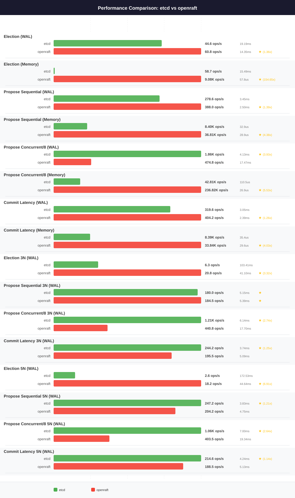
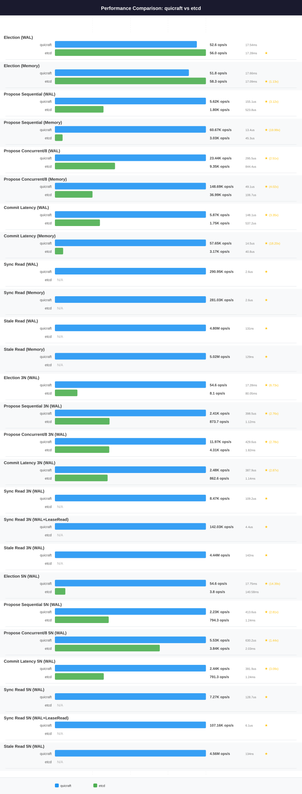
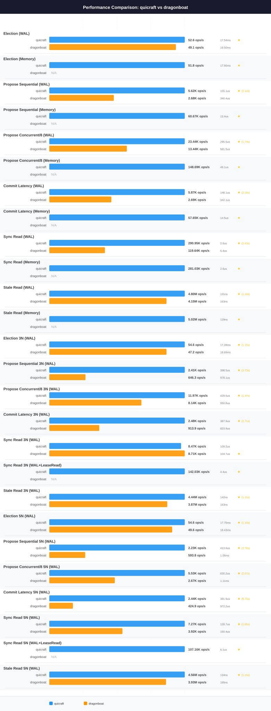
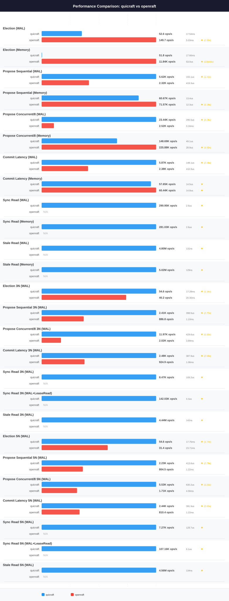

# R640 — Analysis and Preserved Baseline

**This file predates the profile-based generated pipeline, and the generator
never writes to it.** Everything below is hand-written: the measured tables, the
head-to-head prose, the fairness audit. It is the human's file.

| | |
|---|---|
| **Machine** | Dell EMC PowerEdge R640, 2x Intel Xeon Platinum 8260 @ 2.40GHz (24C/48T each, 96 threads), 384 GiB DDR4, NVMe SSD, 2 NUMA nodes |
| **Measured** | 2026-03-18, commit `3d92cd2`, BENCHTIME=30s |
| **Status** | Offline pending hardware repair |

## Why this profile has no generated documents

The R640 numbers were never captured as result JSON. They exist only as the
rendered markdown tables reproduced verbatim below, which came out of a
generator that no longer exists in this form. Reconstructing JSON by parsing
those tables would put a lossily transcribed baseline into a file the project
treats as measured data, so it was not done: a silent transcription error in a
baseline is worse than having no baseline.

`etcd.md`, `dragonboat.md` and `openraft.md` therefore do not exist in this
profile, and no placeholder stands in for them — a document full of `N/A` is
indistinguishable at a glance from a real result of zero. They appear the first
time the R640 is re-run under the new harness:

```
make perf-remote PERF_HOST=<user>@<r640> PERF_PROFILE=r640
```

That run captures `env.json` on the machine, writes `results/*.json`, and
generates the three documents beside this one. This file survives that run
untouched.

## What was preserved here, and from where

The four documents below are reproduced **byte for byte** from the files they
name. Nothing was edited, summarised or re-rendered.

| Section | Original path |
|---|---|
| [Preserved: README.md](#preserved-testperformancereadmemd) | `test/performance/README.md` |
| [Preserved: etcd.md](#preserved-testperformanceetcdmd) | `test/performance/etcd.md` |
| [Preserved: dragonboat.md](#preserved-testperformancedragonboatmd) | `test/performance/dragonboat.md` |
| [Preserved: openraft.md](#preserved-testperformanceopenraftmd) | `test/performance/openraft.md` |

The chart SVGs those documents reference moved with them, from
`test/performance/charts/` to `test/performance/profiles/r640/charts/`, so every
relative image link below still resolves. Cross-document links do not: a link
that read `[etcd.md](etcd.md)` pointed at a sibling file that is now a section of
this one. Those links were left as written rather than rewritten, because the
mandate was verbatim preservation.

Two facts stated in the preserved README are now out of date and are corrected
here rather than in the text below: the secondary omega dataset it points at
(`omega.md`, `omega/`, `results-omega/`) never existed at those paths, and the
`Architecture` section's layout diagram describes the pre-profile tree. The
current layout is in [../../README.md](../../README.md).

---

## Preserved: `test/performance/README.md`

<!-- BEGIN-VERBATIM test/performance/README.md -->
# Performance Benchmarks

Comparative benchmarks measuring QuicRaft against etcd, Dragonboat, OpenRaft
across four deployment configurations: single-node in-memory, single-node WAL, 3-node
cluster with mTLS, and 5-node cluster with mTLS.

## Which dataset you are reading

Every number in **this file** comes from one machine, a Dell EMC PowerEdge R640,
measured on **2026-03-18** at commit **3d92cd2**. That is the baseline of record.
The R640 is currently offline with a hardware failure; a fresh run is expected
once it is repaired, and that run will replace the numbers here.

A second, smaller dataset exists: [omega.md](omega.md), measured 2026-08-17 on a
single-socket Intel i9-9900X workstation. It is a secondary datapoint, not a
refresh. **Do not compare a value in this file against a value in `omega.md`,
and do not compute a ratio across the two.** They are different machines, and
they are also different builds of the engine (see below). Each file is
internally consistent; nothing across them is.

Two things to hold in mind about the R640 set specifically:

- The numbers predate a large amount of engine work, including the 0.5.x
  on-disk format change and two hardening campaigns. They characterize the
  March build on that hardware, not today's `0.5.1-alpha`.
- The benchmark harnesses themselves have changed since March (ten commits
  under `test/performance/`). The caveats in [Fairness and comparability](#fairness-and-comparability)
  were read from the current harness; where one is known to apply to the March
  harness as well, it says so.



## Quick Start

The run-once pipeline runs each system exactly once, saves JSON, then renders
charts and the pairwise markdown from that JSON:

```bash
make perf-all                    # perf-run-all, then perf-generate
make perf-run-all                # phase 1 only: run everything, save JSON to ./results
make perf-generate               # phase 2 only: charts + pairwise markdown from ./results

# Knobs
make perf-all BENCHTIME=30s PERF_TIMEOUT=7200s PERF_EXTRA=--no-build
```

Individual systems and ad-hoc pairwise comparisons:

```bash
# Compare QuicRaft vs a specific system (builds Docker images, runs benchmarks, generates charts)
make perf-compare-etcd
make perf-compare-dragonboat
make perf-compare-openraft

# Compare all systems at once
make perf-compare-all

# Run a single system standalone
make perf-quicraft
make perf-etcd
make perf-dragonboat
make perf-openraft
```

**`perf-generate` overwrites files.** It writes `etcd.md`, `dragonboat.md`,
`openraft.md` and everything under the chart directory, from whatever JSON is in
the results directory. It does *not* write this README. Run it against the
default directories only when you intend to replace the R640 baseline. To
generate a second dataset without touching the baseline, point it elsewhere:

```bash
cd test/performance
./perfcompare generate --results-dir=results-omega --output-dir=omega --chart-dir=charts/omega
```

## Test Environment (R640 baseline, 2026-03-18)

| Component | Specification |
|-----------|--------------|
| **Server** | Dell EMC PowerEdge R640 |
| **CPU** | 2x Intel Xeon Platinum 8260 @ 2.40GHz (24 cores / 48 threads each, 96 threads total) |
| **L3 Cache** | 71.5 MiB (35.75 MiB per socket) |
| **Memory** | 384 GiB DDR4 |
| **Storage** | NVMe SSD (6.4T, model 7335940:ICDPC2DD2ORA6.4T) |
| **NUMA** | 2 nodes, interleaved core assignment |
| **OS** | Ubuntu 24.04.4 LTS (Noble Numbat) |
| **Kernel** | 6.8.0-106-generic |
| **Docker** | 28.2.2 with buildx 0.21.3 |
| **Go** | 1.26.1 linux/amd64 |
| **Benchtime** | 30s per scenario |
| **Measured** | 2026-03-18, commit 3d92cd2 |
| **Status** | Offline pending hardware repair; re-run expected once available |

All benchmarks run inside Docker containers with `--net=host` (QuicRaft also uses `--privileged` for UDP buffer tuning). Each system is benchmarked sequentially to avoid interference.

## Detailed Comparisons

R640 baseline, 2026-03-18. Each of these is written by `perf-generate` and is
overwritten wholesale on the next run.

| Comparison | Link |
|------------|------|
| QuicRaft vs etcd | [etcd.md](etcd.md) |
| QuicRaft vs Dragonboat | [dragonboat.md](dragonboat.md) |
| QuicRaft vs OpenRaft | [openraft.md](openraft.md) |

Secondary dataset, omega, 2026-08-17:

| Comparison | Link |
|------------|------|
| Environment, all four result tables | [omega.md](omega.md) |
| QuicRaft vs etcd | [omega/etcd.md](omega/etcd.md) |
| QuicRaft vs Dragonboat | [omega/dragonboat.md](omega/dragonboat.md) |
| QuicRaft vs OpenRaft | [omega/openraft.md](omega/openraft.md) |

## System Overview

| System | Version | Language | Type | WAL | Memory | Reads | Multi-Group | TLS |
|--------|---------|----------|------|-----|--------|-------|-------------|-----|
| **QuicRaft** | this tree | Go | Engine | waldb (sharded) | memdb | SyncRead, StaleRead | Yes (10K+ shards) | QUIC mTLS (always on) |
| **etcd-io/raft** | v3.6.0 | Go | Library | User-provided | MemoryStorage | User-implemented | No | TCP mutual TLS (3N/5N only) |
| **Dragonboat** | jeremyhahn fork v4.0.1 | Go | Engine | sharded Pebble (default `sharded-pebble` LogDB) | N/A | SyncRead, StaleRead | Yes | TCP MutualTLS |
| **OpenRaft** | 0.9.21 | Rust | Library | Disk WAL, write-only (benchmark) | BTreeMap | User-implemented | No | TCP mutual TLS, 3N/5N only (tokio-rustls) |

The Dragonboat row is a fork, `github.com/jeremyhahn/dragonboat/v4`, not
upstream `lni/dragonboat`. It exists so the benchmark can compile against
PebbleDB v1.1.5. The OpenRaft "Memory" column is its log store; its state
machine is a `HashMap`.

## Benchmark Results (R640, 2026-03-18)

**BENCHTIME**: 30s. Read [Fairness and comparability](#fairness-and-comparability)
before drawing a conclusion from any row. The election rows in particular are
not like-for-like across columns.

### Single-Node In-Memory (Framework Overhead)

Memory-mode benchmarks isolate framework overhead from I/O.

| Scenario | QuicRaft | etcd | Dragonboat | OpenRaft |
|----------|----------|------|------------|----------|
| Election (Memory) | 51.8 ops/s (P50 17.66ms, P95 26.60ms, P99 27.85ms) | 58.3 ops/s (P50 17.09ms, P95 21.95ms, P99 22.97ms) | N/A | 11.84K ops/s (P50 53.0us, P95 92.0us, P99 126.8us) |
| Propose Sequential (Memory) | 60.67K ops/s (P50 13.4us, P95 34.6us, P99 48.5us) | 3.03K ops/s (P50 45.3us, P95 1.14ms, P99 1.20ms) | N/A | 71.57K ops/s (P50 12.3us, P95 21.7us, P99 28.8us) |
| Propose Concurrent/8 (Memory) | 148.69K ops/s (P50 49.1us, P95 85.0us, P99 105.4us) | 36.99K ops/s (P50 106.7us, P95 1.01ms, P99 1.18ms) | N/A | 225.88K ops/s (P50 28.9us, P95 65.2us, P99 90.8us) |
| Commit Latency (Memory) | 57.65K ops/s (P50 14.5us, P95 33.8us, P99 45.9us) | 3.17K ops/s (P50 40.8us, P95 1.14ms, P99 1.20ms) | N/A | 60.44K ops/s (P50 14.8us, P95 26.2us, P99 34.7us) |
| Sync Read (Memory) | 281.03K ops/s (P50 2.6us, P95 7.6us, P99 11.4us) | N/A | N/A | N/A |
| Stale Read (Memory) | 5.02M ops/s (P50 129ns, P95 164ns, P99 367ns) | N/A | N/A | N/A |

### Single-Node WAL (Production-Realistic)

WAL-mode benchmarks include real persistence with fsync.

| Scenario | QuicRaft | etcd | Dragonboat | OpenRaft |
|----------|----------|------|------------|----------|
| Election (WAL) | 52.6 ops/s (P50 17.54ms, P95 23.58ms, P99 27.57ms) | 56.0 ops/s (P50 17.28ms, P95 22.29ms, P99 22.94ms) | 49.1 ops/s (P50 19.50ms, P95 26.34ms, P99 31.16ms) | 149.7 ops/s (P50 5.03ms, P95 6.11ms, P99 6.47ms) |
| Propose Sequential (WAL) | 5.62K ops/s (P50 155.1us, P95 301.4us, P99 586.1us) | 1.80K ops/s (P50 523.8us, P95 768.6us, P99 1.60ms) | 2.68K ops/s (P50 340.4us, P95 508.7us, P99 852.3us) | 2.32K ops/s (P50 419.3us, P95 613.0us, P99 755.6us) |
| Propose Concurrent/8 (WAL) | 23.44K ops/s (P50 295.5us, P95 644.6us, P99 762.9us) | 9.35K ops/s (P50 844.4us, P95 1.11ms, P99 1.27ms) | 13.44K ops/s (P50 581.5us, P95 810.0us, P99 932.6us) | 2.52K ops/s (P50 3.16ms, P95 4.02ms, P99 4.88ms) |
| Commit Latency (WAL) | 5.87K ops/s (P50 148.1us, P95 282.7us, P99 588.6us) | 1.75K ops/s (P50 537.2us, P95 753.5us, P99 1.62ms) | 2.69K ops/s (P50 342.1us, P95 503.4us, P99 762.6us) | 2.38K ops/s (P50 410.9us, P95 580.0us, P99 693.4us) |
| Sync Read (WAL) | 290.95K ops/s (P50 2.6us, P95 7.1us, P99 10.8us) | N/A | 119.64K ops/s (P50 6.4us, P95 18.3us, P99 29.3us) | N/A |
| Stale Read (WAL) | 4.80M ops/s (P50 131ns, P95 247ns, P99 400ns) | N/A | 4.15M ops/s (P50 163ns, P95 242ns, P99 443ns) | N/A |

### 3-Node Cluster with mTLS

All 3N benchmarks use mutual TLS over localhost and a disk WAL with fsync, for
all four systems. TLS 1.3 is pinned as a minimum in the Go harnesses only;
OpenRaft negotiates it without requiring it, and its WAL is write-only. The
election row is not comparable across columns. See
[Fairness and comparability](#fairness-and-comparability).

| Scenario | QuicRaft | etcd | Dragonboat | OpenRaft |
|----------|----------|------|------------|----------|
| Election 3N (WAL) | 54.6 ops/s (P50 17.28ms, P95 23.04ms, P99 27.88ms) | 8.1 ops/s (P50 80.05ms, P95 105.60ms, P99 117.82ms) | 47.2 ops/s (P50 18.69ms, P95 29.77ms, P99 39.86ms) | 40.2 ops/s (P50 20.30ms, P95 21.86ms, P99 23.09ms) |
| Propose Sequential 3N (WAL) | 2.41K ops/s (P50 398.5us, P95 526.2us, P99 659.1us) | 873.7 ops/s (P50 1.12ms, P95 1.47ms, P99 1.67ms) | 646.3 ops/s (P50 978.1us, P95 1.38ms, P99 1.66ms) | 886.8 ops/s (P50 1.10ms, P95 1.46ms, P99 1.73ms) |
| Propose Concurrent/8 3N (WAL) | 11.97K ops/s (P50 429.6us, P95 800.1us, P99 1.12ms) | 4.31K ops/s (P50 1.82ms, P95 2.48ms, P99 2.90ms) | 8.14K ops/s (P50 950.8us, P95 1.26ms, P99 1.50ms) | 2.02K ops/s (P50 3.89ms, P95 5.13ms, P99 6.12ms) |
| Commit Latency 3N (WAL) | 2.48K ops/s (P50 387.9us, P95 521.7us, P99 660.0us) | 862.6 ops/s (P50 1.14ms, P95 1.49ms, P99 1.70ms) | 913.9 ops/s (P50 823.9us, P95 1.15ms, P99 1.45ms) | 924.9 ops/s (P50 1.06ms, P95 1.41ms, P99 1.66ms) |
| Sync Read 3N (WAL) | 8.47K ops/s (P50 109.2us, P95 170.6us, P99 215.3us) | N/A | 8.71K ops/s (P50 104.7us, P95 175.4us, P99 242.3us) | N/A |
| Sync Read 3N (WAL+LeaseRead) | 142.03K ops/s (P50 4.4us, P95 11.1us, P99 18.9us) | N/A | N/A | N/A |
| Stale Read 3N (WAL) | 4.44M ops/s (P50 142ns, P95 273ns, P99 451ns) | N/A | 3.87M ops/s (P50 163ns, P95 313ns, P99 567ns) | N/A |

### 5-Node Cluster with mTLS

5N benchmarks test larger quorum requirements (majority = 3/5) with disk WAL and fsync
for all systems. The etcd column here is configured with a 100-tick election
timeout against everyone else's 10, so the election row understates it by
roughly an order of magnitude. See
[Fairness and comparability](#fairness-and-comparability).

| Scenario | QuicRaft | etcd | Dragonboat | OpenRaft |
|----------|----------|------|------------|----------|
| Election 5N (WAL) | 54.6 ops/s (P50 17.75ms, P95 23.16ms, P99 33.84ms) | 3.8 ops/s (P50 140.58ms, P95 177.81ms, P99 201.92ms) | 49.6 ops/s (P50 18.43ms, P95 24.57ms, P99 37.85ms) | 31.4 ops/s (P50 23.71ms, P95 25.47ms, P99 26.83ms) |
| Propose Sequential 5N (WAL) | 2.23K ops/s (P50 413.6us, P95 658.1us, P99 793.7us) | 794.3 ops/s (P50 1.24ms, P95 1.63ms, P99 1.86ms) | 593.8 ops/s (P50 1.06ms, P95 1.43ms, P99 1.68ms) | 804.5 ops/s (P50 1.22ms, P95 1.62ms, P99 1.88ms) |
| Propose Concurrent/8 5N (WAL) | 5.53K ops/s (P50 630.2us, P95 1.64ms, P99 2.56ms) | 3.84K ops/s (P50 2.03ms, P95 2.75ms, P99 3.26ms) | 2.67K ops/s (P50 1.11ms, P95 1.49ms, P99 1.75ms) | 1.71K ops/s (P50 4.56ms, P95 6.26ms, P99 7.57ms) |
| Commit Latency 5N (WAL) | 2.44K ops/s (P50 391.9us, P95 521.7us, P99 656.6us) | 791.3 ops/s (P50 1.24ms, P95 1.65ms, P99 1.89ms) | 424.9 ops/s (P50 972.2us, P95 1.38ms, P99 1.64ms) | 810.4 ops/s (P50 1.22ms, P95 1.59ms, P99 1.86ms) |
| Sync Read 5N (WAL) | 7.27K ops/s (P50 128.7us, P95 189.1us, P99 229.9us) | N/A | 3.92K ops/s (P50 150.4us, P95 238.4us, P99 351.6us) | N/A |
| Sync Read 5N (WAL+LeaseRead) | 107.16K ops/s (P50 6.1us, P95 13.9us, P99 26.5us) | N/A | N/A | N/A |
| Stale Read 5N (WAL) | 4.56M ops/s (P50 134ns, P95 307ns, P99 443ns) | N/A | 3.93M ops/s (P50 165ns, P95 308ns, P99 581ns) | N/A |

## Performance Summary

**The head-to-head win counts that used to appear here have been removed.** They
were undated, carried no commit SHA, and could not be reconciled with the
project's own recorded measurements. The other set on record, from 2026-02-26/27,
is QuicRaft 7/17 vs Dragonboat, 8/16 vs etcd and 5/16 vs OpenRaft, with
Dragonboat ahead by 3-22x on 3-node and 5-node propose/commit; **the hardware for
that set was never recorded**, so it cannot be lined up against the R640 tables
above either. A summary line that disagrees with the measurement it summarizes is
worse than no summary.

Read the per-scenario tables above and the pairwise documents below instead, and
treat any number here as indicative only: the tables are a single run per system
on one machine, not a statistical comparison. `make bench-compare` (interleaved
baseline-vs-current with benchstat, see `docs/performance/benchmarking.md`) is
the regression gate. `make perf-docs` regenerates the pairwise documents and the
charts but not this file; when you refresh the numbers here, write the date,
commit and machine in beside them.

### Pairwise Ratio Tables

See individual comparison documents for detailed analysis:

- [etcd.md](etcd.md) -- QuicRaft vs etcd
- [dragonboat.md](dragonboat.md) -- QuicRaft vs Dragonboat
- [openraft.md](openraft.md) -- QuicRaft vs OpenRaft

## Feature Availability

| Feature | QuicRaft | etcd | Dragonboat | OpenRaft |
|---------|----------|------|------------|----------|
| Memory-Only Mode | Yes (memdb) | Yes | No | Yes (1N only) |
| Multi-Node WAL | waldb (sharded, fsync) | File WAL (fsync) | sharded Pebble (fsync) | 16-shard WAL (bincode, fdatasync, write-only) |
| Built-in Transport | Yes (QUIC) | No (library) | Yes (TCP) | No (library) |
| Built-in Encryption | AES-GCM | No | No | No |
| Multi-Group | 10K+ shards | No | Yes | No |
| LeaseRead | Yes | No | No | No |

## Scenario Definitions

| Key | Mode | Description |
|-----|------|-------------|
| `election_wal` | WAL | Cold-start election time with persistent storage |
| `election_memory` | Memory | Cold-start election time with in-memory storage |
| `propose_seq_wal` | WAL | Sequential single-writer propose throughput |
| `propose_seq_memory` | Memory | Sequential single-writer propose throughput |
| `propose_conc8_wal` | WAL | 8-writer concurrent propose throughput |
| `propose_conc8_memory` | Memory | 8-writer concurrent propose throughput |
| `commit_latency_wal` | WAL | Per-proposal end-to-end commit latency |
| `commit_latency_memory` | Memory | Per-proposal end-to-end commit latency |
| `sync_read_wal` | WAL | Linearizable read via ReadIndex protocol |
| `sync_read_memory` | Memory | Linearizable read via ReadIndex protocol |
| `stale_read_wal` | WAL | Non-linearizable local state machine read |
| `stale_read_memory` | Memory | Non-linearizable local state machine read |
| `election_3n_wal` | 3N WAL | Cold-start election, 3-node cluster with TLS |
| `propose_seq_3n_wal` | 3N WAL | Sequential propose, 3-node cluster with TLS |
| `propose_conc8_3n_wal` | 3N WAL | 8-writer concurrent propose, 3-node cluster with TLS |
| `commit_latency_3n_wal` | 3N WAL | Per-proposal commit latency, 3-node cluster with TLS |
| `sync_read_3n_wal` | 3N WAL | Linearizable read, 3-node cluster with TLS |
| `stale_read_3n_wal` | 3N WAL | Local state machine read, 3-node cluster with TLS |
| `election_5n_wal` | 5N WAL | Cold-start election, 5-node cluster with TLS |
| `propose_seq_5n_wal` | 5N WAL | Sequential propose, 5-node cluster with TLS |
| `propose_conc8_5n_wal` | 5N WAL | 8-writer concurrent propose, 5-node cluster with TLS |
| `commit_latency_5n_wal` | 5N WAL | Per-proposal commit latency, 5-node cluster with TLS |
| `sync_read_5n_wal` | 5N WAL | Linearizable read, 5-node cluster with TLS |
| `stale_read_5n_wal` | 5N WAL | Local state machine read, 5-node cluster with TLS |
| `sync_read_3n_wal_leaseread` | 3N WAL | Linearizable read with LeaseRead, 3-node cluster (QuicRaft only) |
| `sync_read_5n_wal_leaseread` | 5N WAL | Linearizable read with LeaseRead, 5-node cluster (QuicRaft only) |

## Fairness and comparability

> This section describes the harnesses as they were when this profile was
> measured (2026-08). The current harnesses follow the rules in
> [Fairness](../../README.md#fairness).

This section was rewritten on 2026-08-17 after auditing the four harnesses
against their source. The previous version overstated parity in three places and
was wrong in one. Everything below was read from the harness code, not inferred
from the numbers.

### Rows that are not like-for-like across columns

**Election.** The four harnesses time different spans, so the election rows
compare different work. QuicRaft (`quicraft/bench.go:449-471`) and Dragonboat
(`dragonboat/dragonboat_bench.go:661-684`) bring up hosts, transport and TLS
*outside* the timer and measure only shard start plus the wait for a leader.
The etcd harness (`etcd/etcd_bench.go:903-912`) times the whole of
`SetupEtcdCluster`: TLS material generation, port allocation, node
construction, listener binds, conf-change application and a warmup proposal.
OpenRaft's cluster election benchmark (`openraft/src/scenarios.rs:371-376`)
does the same. Read election numbers down a column across cluster sizes, not
across columns.

**Election timeout is not held constant.** The etcd harness scales
`ElectionTick` with cluster size: 10 at 1N, 50 at 3N, 100 at 5N, on a 1 ms tick
(`etcd/cluster.go:80-89`). QuicRaft and Dragonboat use `ElectionRTT: 10` at
every size. At 5N the etcd node is configured to wait roughly ten times longer
before campaigning, which accounts for most of the 5N election gap by itself.
This scaling was already present at commit 3d92cd2, so it applies to the R640
numbers above.

**OpenRaft's single-node election is not an election.** `make_raft` and
`make_raft_wal` call `Raft::initialize` (`openraft/src/scenarios.rs:71,87`),
which grants leadership immediately, so there is no randomized timeout to wait
out. The etcd harness deliberately avoids `Campaign()` in order to measure a
natural timeout. The single-node election rows measure different phenomena and
the ratio between them means nothing.

**OpenRaft's raft timing constants differ by an order of magnitude.**
`heartbeat_interval: 50 ms` and `election_timeout_min/max: 150/300 ms`
(`openraft/src/cluster.rs:116-119`), against Go engines on a 1 ms tick with an
election timeout near 10 ms. This affects every multi-node OpenRaft row, not
only the election ones.

### Where the payloads differ

All four propose a 128-byte command in the same wire format
`[op:1][keyLen:2 BE][key][value padding]`. The bytes are not identical in every
scenario:

- `propose_seq_*`: all four use the key `bench-key`. Identical.
- `propose_conc8_*`: QuicRaft and Dragonboat give each of the 8 writers its own
  key (`key-%d`); etcd and OpenRaft have all 8 writers hit a single shared key.
  That is a different apply-path contention pattern, not just different bytes.
- `commit_latency_*`: QuicRaft and Dragonboat use `commit-key` (10 bytes, 115
  byte value); etcd and OpenRaft use `bench-key` (9 bytes, 116 byte value).

What reaches the log also differs. OpenRaft wraps the payload in a
bincode-serialized struct (an extra 8-byte length prefix), Dragonboat wraps it
in a NoOP-session proposal, and etcd stores the 128 bytes raw.

### Warmup

The 100-proposal warmup before commit-latency measurement is real in all four
harnesses. The shared retry budget is not. `benchutil/retry.go` (4 attempts,
500 ms backoff) is used by the three Go harnesses only; OpenRaft is Rust, cannot
import it, and panics on the first warmup error. etcd nominally uses the budget
but `raft.Node.Propose` returns `nil` as soon as the message is queued, so its
retry loop can never fire.

Cluster *setup* warmups are also unequal: QuicRaft does 10 proposals plus a
`SyncRead` and a 50 ms settle; Dragonboat, etcd and OpenRaft do one.

### State machines

Equivalent, and this claim holds. All four parse the KV command, copy the value
and insert into a hash map (`quicraft/kv_sm.go`, `dragonboat/kv_sm.go`,
`etcd/etcd_bench.go`, `openraft/src/store.rs`). Dragonboat takes its lock per
entry rather than per batch, because `IStateMachine.Update` is per-entry.

### Persistence

All four write and flush. QuicRaft uses real `waldb`; Dragonboat uses its default sharded Pebble LogDB at
library defaults; the etcd harness writes entries plus hard state and calls
`Sync()` once per ready.

OpenRaft's benchmark WAL needs a caveat. It is 16 sharded files with parallel
`sync_data()` (`openraft/src/sharded_disk_store.rs:216-236`), so it reproduces
the fsync cost, but it is **write-only**: reads are served from an in-memory
`BTreeMap`, and truncate and purge mutate only that map. Nothing ever reads
`wal.bin` back, so it is not a recoverable log. `sync_data()` is also
`fdatasync` where the etcd harness's `Sync()` is `fsync`.

### Transport

| System | 1N | 3N / 5N |
|---|---|---|
| QuicRaft | QUIC, mTLS (mandatory; config rejects transport without it) | same |
| Dragonboat | TCP, `MutualTLS: true` | same |
| etcd | no transport at all in the propose/commit scenarios | TCP, TLS 1.3, `RequireAndVerifyClientCert` |
| OpenRaft | no-op network | TCP, mutual TLS via tokio-rustls |

Two corrections to what this file used to say. The claim that "OpenRaft
scenarios run with a no-op network" is true only at 1N; the 3N and 5N scenarios
use a real loopback TCP transport with mutual TLS
(`openraft/src/transport.rs:96-145`). And the claim that all 3N benchmarks use
TLS 1.3 is enforced only in the Go harnesses; OpenRaft's rustls is built with
the `tls12` feature and sets no minimum version, so 1.3 is negotiated in
practice but not required.

etcd's 1N election benchmark does stand up a TLS listener, but it is
server-auth-only and its accept loop closes each connection immediately. It is a
cost stand-in that carries no traffic, not mutual TLS.

### etcd completion detection

Raw etcd/raft has no per-proposal acknowledgement API, so its benchmarks reserve
a sequence number before proposing and wait until the node's *total* applied
count reaches that number. Under concurrency another goroutine's proposal can
satisfy the wait, which may under-report etcd per-operation latency relative to
QuicRaft and Dragonboat `SyncPropose`, which both wait for their own proposal to
apply.

### What "N/A" means

A cell is N/A when the scenario key is absent from that system's result map.
There is no separate "attempted and failed" state, so a harness that crashed
renders identically to a scenario nobody wrote. For the R640 tables above every
N/A is an unimplemented scenario; check the coverage table below before assuming
that of any future run.

| Scenario family | QuicRaft | etcd | Dragonboat | OpenRaft |
|---|:--:|:--:|:--:|:--:|
| election / propose / commit, memory | yes | yes | no | yes |
| election / propose / commit, WAL 1N | yes | yes | yes | yes |
| election / propose / commit, 3N and 5N | yes | yes | yes | yes |
| sync read, stale read (all modes) | yes | no | yes | no |
| sync read with LeaseRead, 3N and 5N | yes | no | no | no |

etcd and OpenRaft are benchmarked as libraries and implement no read protocol,
which is why their read rows are empty. Dragonboat has no memory-only mode.
Totals: QuicRaft 26 scenarios, Dragonboat 18, etcd 16, OpenRaft 16.

### Version pins

`etcd/go.mod` pinned `go.etcd.io/raft/v3 v3.6.0` when this dataset was taken; the
tree has since moved to v3.7.0, whose pointer-valued `raftpb` types
change the etcd harness's own allocation profile, so the etcd column here is
not directly comparable to a fresh run without re-measuring (see
`etcd/README.md`, "Baseline version"). `dragonboat/go.mod` pins
`github.com/jeremyhahn/dragonboat/v4 v4.0.1`, which is a **fork** of upstream
`lni/dragonboat`, not upstream itself; it exists because the benchmark needs a
Dragonboat that compiles against PebbleDB v1.1.5. `openraft/Cargo.toml` requests
`0.9` and `Cargo.lock` resolves it to `0.9.21`, though the emitted suite
hardcodes the version string `v0.9`.

## Architecture

```
test/performance/
  README.md              <- This file. HAND-MAINTAINED; perfcompare never writes it.
  etcd.md                <- GENERATED. QuicRaft vs etcd-io/raft, R640 baseline
  dragonboat.md          <- GENERATED. QuicRaft vs Dragonboat, R640 baseline
  openraft.md            <- GENERATED. QuicRaft vs OpenRaft, R640 baseline
  omega.md               <- HAND-MAINTAINED. Secondary dataset, environment + tables
  omega/                 <- GENERATED. Pairwise markdown for the omega dataset
  results-omega/         <- Stored JSON for the omega dataset
  perfresult/            <- Shared types, comparison engine, chart generation
  benchutil/             <- Shared warmup retry budget (Go harnesses only)
  cmd/perfcompare/       <- Go CLI orchestrator (Docker-based execution)
  quicraft/              <- QuicRaft benchmarks (standalone module)
  etcd/                  <- etcd-io/raft benchmarks (standalone module)
  dragonboat/            <- Dragonboat benchmarks (standalone module)
  openraft/              <- OpenRaft (Rust) benchmarks (standalone crate)
  baselines/             <- Committed bench-compare baselines (see docs/performance/benchmarking.md)
  charts/                <- SVG charts. R640 charts at the top level, omega under charts/omega/
```

The earlier version of this section described the README as auto-generated. It
is not. `perfcompare generate` writes `<system>.md` for each non-QuicRaft system
plus the charts, and nothing else; the README, `omega.md`, `PROFILING_ANALYSIS.md`
and the prose under `docs/performance/` are all maintained by hand.
<!-- END-VERBATIM test/performance/README.md -->

## Preserved: `test/performance/etcd.md`

<!-- BEGIN-VERBATIM test/performance/etcd.md -->
# QuicRaft vs etcd Performance Comparison

**Date**: 2026-03-18 (fresh benchmark run, BENCHTIME=30s, isolated sequential Docker runs)
**BENCHTIME**: 30s
**Hardware**: Dell EMC PowerEdge R640, 2x Xeon Platinum 8260 (96 threads), 384 GiB, NVMe, 2 NUMA nodes. See [README.md](README.md#test-environment-r640-baseline-2026-03-18).

> Every number below is from the R640 baseline. The secondary omega dataset lives
> in [omega/etcd.md](omega/etcd.md) and was measured on different hardware — do not
> compare a value here against a value there.

## Charts



> Regenerate: `make perf-compare-etcd`

## Head-to-Head Summary

**QuicRaft wins 14 out of 16 comparable head-to-head scenarios.** etcd wins 2.

| Scenario | QuicRaft | etcd | Winner | Ratio |
|----------|----------|------|--------|-------|
| Election (WAL) | 52.6 ops/s (P50 17.54ms, P95 23.58ms, P99 27.57ms) | 56.0 ops/s (P50 17.28ms, P95 22.29ms, P99 22.94ms) | etcd | 1.06x |
| Election (Memory) | 51.8 ops/s (P50 17.66ms, P95 26.60ms, P99 27.85ms) | 58.3 ops/s (P50 17.09ms, P95 21.95ms, P99 22.97ms) | etcd | 1.13x |
| Propose Sequential (WAL) | 5.62K ops/s (P50 155.1us, P95 301.4us, P99 586.1us) | 1.80K ops/s (P50 523.8us, P95 768.6us, P99 1.60ms) | QuicRaft | 3.12x |
| Propose Sequential (Memory) | 60.67K ops/s (P50 13.4us, P95 34.6us, P99 48.5us) | 3.03K ops/s (P50 45.3us, P95 1.14ms, P99 1.20ms) | QuicRaft | 19.99x |
| Propose Concurrent/8 (WAL) | 23.44K ops/s (P50 295.5us, P95 644.6us, P99 762.9us) | 9.35K ops/s (P50 844.4us, P95 1.11ms, P99 1.27ms) | QuicRaft | 2.51x |
| Propose Concurrent/8 (Memory) | 148.69K ops/s (P50 49.1us, P95 85.0us, P99 105.4us) | 36.99K ops/s (P50 106.7us, P95 1.01ms, P99 1.18ms) | QuicRaft | 4.02x |
| Commit Latency (WAL) | 5.87K ops/s (P50 148.1us, P95 282.7us, P99 588.6us) | 1.75K ops/s (P50 537.2us, P95 753.5us, P99 1.62ms) | QuicRaft | 3.35x |
| Commit Latency (Memory) | 57.65K ops/s (P50 14.5us, P95 33.8us, P99 45.9us) | 3.17K ops/s (P50 40.8us, P95 1.14ms, P99 1.20ms) | QuicRaft | 18.20x |
| Election 3N (WAL) | 54.6 ops/s (P50 17.28ms, P95 23.04ms, P99 27.88ms) | 8.1 ops/s (P50 80.05ms, P95 105.60ms, P99 117.82ms) | QuicRaft | 6.73x |
| Propose Sequential 3N (WAL) | 2.41K ops/s (P50 398.5us, P95 526.2us, P99 659.1us) | 873.7 ops/s (P50 1.12ms, P95 1.47ms, P99 1.67ms) | QuicRaft | 2.76x |
| Propose Concurrent/8 3N (WAL) | 11.97K ops/s (P50 429.6us, P95 800.1us, P99 1.12ms) | 4.31K ops/s (P50 1.82ms, P95 2.48ms, P99 2.90ms) | QuicRaft | 2.78x |
| Commit Latency 3N (WAL) | 2.48K ops/s (P50 387.9us, P95 521.7us, P99 660.0us) | 862.6 ops/s (P50 1.14ms, P95 1.49ms, P99 1.70ms) | QuicRaft | 2.87x |
| Election 5N (WAL) | 54.6 ops/s (P50 17.75ms, P95 23.16ms, P99 33.84ms) | 3.8 ops/s (P50 140.58ms, P95 177.81ms, P99 201.92ms) | QuicRaft | 14.39x |
| Propose Sequential 5N (WAL) | 2.23K ops/s (P50 413.6us, P95 658.1us, P99 793.7us) | 794.3 ops/s (P50 1.24ms, P95 1.63ms, P99 1.86ms) | QuicRaft | 2.81x |
| Propose Concurrent/8 5N (WAL) | 5.53K ops/s (P50 630.2us, P95 1.64ms, P99 2.56ms) | 3.84K ops/s (P50 2.03ms, P95 2.75ms, P99 3.26ms) | QuicRaft | 1.44x |
| Commit Latency 5N (WAL) | 2.44K ops/s (P50 391.9us, P95 521.7us, P99 656.6us) | 791.3 ops/s (P50 1.24ms, P95 1.65ms, P99 1.89ms) | QuicRaft | 3.09x |

10 additional scenarios exclusive to QuicRaft — see [Exclusive Scenarios](#exclusive-scenarios) below.

## Single-Node (1N) WAL Results

| Scenario | QuicRaft | etcd | Winner | Ratio |
|----------|----------|------|--------|-------|
| Election (WAL) | 52.6 ops/s, P50 17.54ms, P95 23.58ms, P99 27.57ms | 56.0 ops/s, P50 17.28ms, P95 22.29ms, P99 22.94ms | etcd | 1.06x |
| Propose Sequential (WAL) | 5.62K ops/s, P50 155.1us, P95 301.4us, P99 586.1us | 1.80K ops/s, P50 523.8us, P95 768.6us, P99 1.60ms | QuicRaft | 3.12x |
| Propose Concurrent/8 (WAL) | 23.44K ops/s, P50 295.5us, P95 644.6us, P99 762.9us | 9.35K ops/s, P50 844.4us, P95 1.11ms, P99 1.27ms | QuicRaft | 2.51x |
| Commit Latency (WAL) | 5.87K ops/s, P50 148.1us, P95 282.7us, P99 588.6us | 1.75K ops/s, P50 537.2us, P95 753.5us, P99 1.62ms | QuicRaft | 3.35x |

## Single-Node (1N) Memory Results

| Scenario | QuicRaft | etcd | Winner | Ratio |
|----------|----------|------|--------|-------|
| Election (Memory) | 51.8 ops/s, P50 17.66ms, P95 26.60ms, P99 27.85ms | 58.3 ops/s, P50 17.09ms, P95 21.95ms, P99 22.97ms | etcd | 1.13x |
| Propose Sequential (Memory) | 60.67K ops/s, P50 13.4us, P95 34.6us, P99 48.5us | 3.03K ops/s, P50 45.3us, P95 1.14ms, P99 1.20ms | QuicRaft | 19.99x |
| Propose Concurrent/8 (Memory) | 148.69K ops/s, P50 49.1us, P95 85.0us, P99 105.4us | 36.99K ops/s, P50 106.7us, P95 1.01ms, P99 1.18ms | QuicRaft | 4.02x |
| Commit Latency (Memory) | 57.65K ops/s, P50 14.5us, P95 33.8us, P99 45.9us | 3.17K ops/s, P50 40.8us, P95 1.14ms, P99 1.20ms | QuicRaft | 18.20x |

## 3-Node Cluster (3N) Results

All 3N benchmarks use TLS 1.3 with mutual authentication over localhost.

| Scenario | QuicRaft | etcd | Winner | Ratio |
|----------|----------|------|--------|-------|
| Election 3N (WAL) | 54.6 ops/s, P50 17.28ms, P95 23.04ms, P99 27.88ms | 8.1 ops/s, P50 80.05ms, P95 105.60ms, P99 117.82ms | QuicRaft | 6.73x |
| Propose Sequential 3N (WAL) | 2.41K ops/s, P50 398.5us, P95 526.2us, P99 659.1us | 873.7 ops/s, P50 1.12ms, P95 1.47ms, P99 1.67ms | QuicRaft | 2.76x |
| Propose Concurrent/8 3N (WAL) | 11.97K ops/s, P50 429.6us, P95 800.1us, P99 1.12ms | 4.31K ops/s, P50 1.82ms, P95 2.48ms, P99 2.90ms | QuicRaft | 2.78x |
| Commit Latency 3N (WAL) | 2.48K ops/s, P50 387.9us, P95 521.7us, P99 660.0us | 862.6 ops/s, P50 1.14ms, P95 1.49ms, P99 1.70ms | QuicRaft | 2.87x |

## 5-Node Cluster (5N) Results

All 5N benchmarks use TLS 1.3 with mutual authentication over localhost, identical to 3N.

| Scenario | QuicRaft | etcd | Winner | Ratio |
|----------|----------|------|--------|-------|
| Election 5N (WAL) | 54.6 ops/s, P50 17.75ms, P95 23.16ms, P99 33.84ms | 3.8 ops/s, P50 140.58ms, P95 177.81ms, P99 201.92ms | QuicRaft | 14.39x |
| Propose Sequential 5N (WAL) | 2.23K ops/s, P50 413.6us, P95 658.1us, P99 793.7us | 794.3 ops/s, P50 1.24ms, P95 1.63ms, P99 1.86ms | QuicRaft | 2.81x |
| Propose Concurrent/8 5N (WAL) | 5.53K ops/s, P50 630.2us, P95 1.64ms, P99 2.56ms | 3.84K ops/s, P50 2.03ms, P95 2.75ms, P99 3.26ms | QuicRaft | 1.44x |
| Commit Latency 5N (WAL) | 2.44K ops/s, P50 391.9us, P95 521.7us, P99 656.6us | 791.3 ops/s, P50 1.24ms, P95 1.65ms, P99 1.89ms | QuicRaft | 3.09x |

## Exclusive Scenarios

The following scenarios were only measured for QuicRaft (etcd does not expose equivalent benchmarks):

| Scenario | Throughput | Latency |
|----------|-----------|---------|
| Sync Read (WAL) | 290.95K ops/s | P50 2.6us, P95 7.1us, P99 10.8us |
| Sync Read (Memory) | 281.03K ops/s | P50 2.6us, P95 7.6us, P99 11.4us |
| Stale Read (WAL) | 4.80M ops/s | P50 131ns, P95 247ns, P99 400ns |
| Stale Read (Memory) | 5.02M ops/s | P50 129ns, P95 164ns, P99 367ns |
| Sync Read 3N (WAL) | 8.47K ops/s | P50 109.2us, P95 170.6us, P99 215.3us |
| Sync Read 3N (WAL+LeaseRead) | 142.03K ops/s | P50 4.4us, P95 11.1us, P99 18.9us |
| Stale Read 3N (WAL) | 4.44M ops/s | P50 142ns, P95 273ns, P99 451ns |
| Sync Read 5N (WAL) | 7.27K ops/s | P50 128.7us, P95 189.1us, P99 229.9us |
| Sync Read 5N (WAL+LeaseRead) | 107.16K ops/s | P50 6.1us, P95 13.9us, P99 26.5us |
| Stale Read 5N (WAL) | 4.56M ops/s | P50 134ns, P95 307ns, P99 443ns |

## Test Configuration

### Single-Node (1N)

| Parameter | QuicRaft | etcd |
|-----------|----------|------|
| Benchtime | 30s | 30s |
| Payload | 128 bytes | 128 bytes |
| Concurrent Goroutines | 8 | 8 |
| TLS | Yes | No |
| Election RTT | 10 ticks | 10 ticks |
| Heartbeat RTT | 1 tick | 1 tick |
| RTT | 1ms | 1ms |

### Multi-Node (3N/5N)

| Parameter | QuicRaft | etcd |
|-----------|----------|------|
| Benchtime | 30s | 30s |
| TLS | TLS 1.3, mutual auth | TLS 1.3, mutual auth |
| Topology | In-process, localhost | In-process, localhost |
| Election RTT | 10 ticks | 10 ticks |
| Heartbeat RTT | 1 tick | 1 tick |
| RTT | 1ms | 1ms |
| Payload | 128 bytes | 128 bytes |
| Concurrent Goroutines | 8 | 8 |

## Analysis

### Architecture Comparison

| Aspect | QuicRaft | etcd-io/raft |
|--------|----------|--------------|
| **Type** | Engine (batteries-included) | Library (bring your own transport/storage) |
| **Transport** | QUIC with built-in mTLS | User-provided (benchmark uses TCP+TLS) |
| **WAL** | waldb (16-shard, parallel fsync) | User-provided (benchmark uses bbolt) |
| **State Machine** | Pluggable (in-memory and on-disk) | User-implemented |
| **Multi-Group** | 10K+ shards per host | No (single group per instance) |
| **Read Path** | ReadIndex + LeaseRead | User-implemented ReadIndex |
| **Pipeline** | 3-stage (Step/Commit/Apply) | User-controlled event loop |

### Key Differences

**Engine vs Library**: QuicRaft is a complete engine with integrated transport, storage, and read protocols. etcd-io/raft is a library that requires the user to implement transport, storage, and the ReadIndex protocol. This means etcd performance is highly dependent on the integrator's implementation choices.

**Multi-Group**: QuicRaft supports 10K+ shards per host natively. etcd-io/raft is single-group per instance — multi-group requires running multiple raft instances.

**Read Path**: QuicRaft provides built-in SyncRead (ReadIndex), LeaseRead, and StaleRead. etcd-io/raft exposes ReadIndex messages but the user must implement the full read protocol.
<!-- END-VERBATIM test/performance/etcd.md -->

## Preserved: `test/performance/dragonboat.md`

<!-- BEGIN-VERBATIM test/performance/dragonboat.md -->
# QuicRaft vs Dragonboat Performance Comparison

**Date**: 2026-03-18 (fresh benchmark run, BENCHTIME=30s, isolated sequential Docker runs)
**BENCHTIME**: 30s
**Hardware**: Dell EMC PowerEdge R640, 2x Xeon Platinum 8260 (96 threads), 384 GiB, NVMe, 2 NUMA nodes. See [README.md](README.md#test-environment-r640-baseline-2026-03-18).

> Every number below is from the R640 baseline. The secondary omega dataset lives
> in [omega/dragonboat.md](omega/dragonboat.md) and was measured on different
> hardware — do not compare a value here against a value there.

## Charts



> Regenerate: `make perf-compare-dragonboat`

## Head-to-Head Summary

**QuicRaft wins 17 out of 18 comparable head-to-head scenarios.** Dragonboat wins 0, with 1 virtual tie.

| Scenario | QuicRaft | Dragonboat | Winner | Ratio |
|----------|----------|------------|--------|-------|
| Election (WAL) | 52.6 ops/s (P50 17.54ms, P95 23.58ms, P99 27.57ms) | 49.1 ops/s (P50 19.50ms, P95 26.34ms, P99 31.16ms) | QuicRaft | 1.07x |
| Propose Sequential (WAL) | 5.62K ops/s (P50 155.1us, P95 301.4us, P99 586.1us) | 2.68K ops/s (P50 340.4us, P95 508.7us, P99 852.3us) | QuicRaft | 2.10x |
| Propose Concurrent/8 (WAL) | 23.44K ops/s (P50 295.5us, P95 644.6us, P99 762.9us) | 13.44K ops/s (P50 581.5us, P95 810.0us, P99 932.6us) | QuicRaft | 1.74x |
| Commit Latency (WAL) | 5.87K ops/s (P50 148.1us, P95 282.7us, P99 588.6us) | 2.69K ops/s (P50 342.1us, P95 503.4us, P99 762.6us) | QuicRaft | 2.18x |
| Sync Read (WAL) | 290.95K ops/s (P50 2.6us, P95 7.1us, P99 10.8us) | 119.64K ops/s (P50 6.4us, P95 18.3us, P99 29.3us) | QuicRaft | 2.43x |
| Stale Read (WAL) | 4.80M ops/s (P50 131ns, P95 247ns, P99 400ns) | 4.15M ops/s (P50 163ns, P95 242ns, P99 443ns) | QuicRaft | 1.16x |
| Election 3N (WAL) | 54.6 ops/s (P50 17.28ms, P95 23.04ms, P99 27.88ms) | 47.2 ops/s (P50 18.69ms, P95 29.77ms, P99 39.86ms) | QuicRaft | 1.15x |
| Propose Sequential 3N (WAL) | 2.41K ops/s (P50 398.5us, P95 526.2us, P99 659.1us) | 646.3 ops/s (P50 978.1us, P95 1.38ms, P99 1.66ms) | QuicRaft | 3.73x |
| Propose Concurrent/8 3N (WAL) | 11.97K ops/s (P50 429.6us, P95 800.1us, P99 1.12ms) | 8.14K ops/s (P50 950.8us, P95 1.26ms, P99 1.50ms) | QuicRaft | 1.47x |
| Commit Latency 3N (WAL) | 2.48K ops/s (P50 387.9us, P95 521.7us, P99 660.0us) | 913.9 ops/s (P50 823.9us, P95 1.15ms, P99 1.45ms) | QuicRaft | 2.71x |
| Sync Read 3N (WAL) | 8.47K ops/s (P50 109.2us, P95 170.6us, P99 215.3us) | 8.71K ops/s (P50 104.7us, P95 175.4us, P99 242.3us) | Tied | 1.03x |
| Stale Read 3N (WAL) | 4.44M ops/s (P50 142ns, P95 273ns, P99 451ns) | 3.87M ops/s (P50 163ns, P95 313ns, P99 567ns) | QuicRaft | 1.15x |
| Election 5N (WAL) | 54.6 ops/s (P50 17.75ms, P95 23.16ms, P99 33.84ms) | 49.6 ops/s (P50 18.43ms, P95 24.57ms, P99 37.85ms) | QuicRaft | 1.10x |
| Propose Sequential 5N (WAL) | 2.23K ops/s (P50 413.6us, P95 658.1us, P99 793.7us) | 593.8 ops/s (P50 1.06ms, P95 1.43ms, P99 1.68ms) | QuicRaft | 3.76x |
| Propose Concurrent/8 5N (WAL) | 5.53K ops/s (P50 630.2us, P95 1.64ms, P99 2.56ms) | 2.67K ops/s (P50 1.11ms, P95 1.49ms, P99 1.75ms) | QuicRaft | 2.07x |
| Commit Latency 5N (WAL) | 2.44K ops/s (P50 391.9us, P95 521.7us, P99 656.6us) | 424.9 ops/s (P50 972.2us, P95 1.38ms, P99 1.64ms) | QuicRaft | 5.75x |
| Sync Read 5N (WAL) | 7.27K ops/s (P50 128.7us, P95 189.1us, P99 229.9us) | 3.92K ops/s (P50 150.4us, P95 238.4us, P99 351.6us) | QuicRaft | 1.85x |
| Stale Read 5N (WAL) | 4.56M ops/s (P50 134ns, P95 307ns, P99 443ns) | 3.93M ops/s (P50 165ns, P95 308ns, P99 581ns) | QuicRaft | 1.16x |

8 additional scenarios exclusive to QuicRaft — see [Exclusive Scenarios](#exclusive-scenarios) below.

## Single-Node (1N) WAL Results

| Scenario | QuicRaft | Dragonboat | Winner | Ratio |
|----------|----------|------------|--------|-------|
| Election (WAL) | 52.6 ops/s, P50 17.54ms, P95 23.58ms, P99 27.57ms | 49.1 ops/s, P50 19.50ms, P95 26.34ms, P99 31.16ms | QuicRaft | 1.07x |
| Propose Sequential (WAL) | 5.62K ops/s, P50 155.1us, P95 301.4us, P99 586.1us | 2.68K ops/s, P50 340.4us, P95 508.7us, P99 852.3us | QuicRaft | 2.10x |
| Propose Concurrent/8 (WAL) | 23.44K ops/s, P50 295.5us, P95 644.6us, P99 762.9us | 13.44K ops/s, P50 581.5us, P95 810.0us, P99 932.6us | QuicRaft | 1.74x |
| Commit Latency (WAL) | 5.87K ops/s, P50 148.1us, P95 282.7us, P99 588.6us | 2.69K ops/s, P50 342.1us, P95 503.4us, P99 762.6us | QuicRaft | 2.18x |
| Sync Read (WAL) | 290.95K ops/s, P50 2.6us, P95 7.1us, P99 10.8us | 119.64K ops/s, P50 6.4us, P95 18.3us, P99 29.3us | QuicRaft | 2.43x |
| Stale Read (WAL) | 4.80M ops/s, P50 131ns, P95 247ns, P99 400ns | 4.15M ops/s, P50 163ns, P95 242ns, P99 443ns | QuicRaft | 1.16x |

## 3-Node Cluster (3N) Results

All 3N benchmarks use TLS 1.3 with mutual authentication over localhost.

| Scenario | QuicRaft | Dragonboat | Winner | Ratio |
|----------|----------|------------|--------|-------|
| Election 3N (WAL) | 54.6 ops/s, P50 17.28ms, P95 23.04ms, P99 27.88ms | 47.2 ops/s, P50 18.69ms, P95 29.77ms, P99 39.86ms | QuicRaft | 1.15x |
| Propose Sequential 3N (WAL) | 2.41K ops/s, P50 398.5us, P95 526.2us, P99 659.1us | 646.3 ops/s, P50 978.1us, P95 1.38ms, P99 1.66ms | QuicRaft | 3.73x |
| Propose Concurrent/8 3N (WAL) | 11.97K ops/s, P50 429.6us, P95 800.1us, P99 1.12ms | 8.14K ops/s, P50 950.8us, P95 1.26ms, P99 1.50ms | QuicRaft | 1.47x |
| Commit Latency 3N (WAL) | 2.48K ops/s, P50 387.9us, P95 521.7us, P99 660.0us | 913.9 ops/s, P50 823.9us, P95 1.15ms, P99 1.45ms | QuicRaft | 2.71x |
| Sync Read 3N (WAL) | 8.47K ops/s, P50 109.2us, P95 170.6us, P99 215.3us | 8.71K ops/s, P50 104.7us, P95 175.4us, P99 242.3us | Tied | 1.03x |
| Stale Read 3N (WAL) | 4.44M ops/s, P50 142ns, P95 273ns, P99 451ns | 3.87M ops/s, P50 163ns, P95 313ns, P99 567ns | QuicRaft | 1.15x |

## 5-Node Cluster (5N) Results

All 5N benchmarks use TLS 1.3 with mutual authentication over localhost, identical to 3N.

| Scenario | QuicRaft | Dragonboat | Winner | Ratio |
|----------|----------|------------|--------|-------|
| Election 5N (WAL) | 54.6 ops/s, P50 17.75ms, P95 23.16ms, P99 33.84ms | 49.6 ops/s, P50 18.43ms, P95 24.57ms, P99 37.85ms | QuicRaft | 1.10x |
| Propose Sequential 5N (WAL) | 2.23K ops/s, P50 413.6us, P95 658.1us, P99 793.7us | 593.8 ops/s, P50 1.06ms, P95 1.43ms, P99 1.68ms | QuicRaft | 3.76x |
| Propose Concurrent/8 5N (WAL) | 5.53K ops/s, P50 630.2us, P95 1.64ms, P99 2.56ms | 2.67K ops/s, P50 1.11ms, P95 1.49ms, P99 1.75ms | QuicRaft | 2.07x |
| Commit Latency 5N (WAL) | 2.44K ops/s, P50 391.9us, P95 521.7us, P99 656.6us | 424.9 ops/s, P50 972.2us, P95 1.38ms, P99 1.64ms | QuicRaft | 5.75x |
| Sync Read 5N (WAL) | 7.27K ops/s, P50 128.7us, P95 189.1us, P99 229.9us | 3.92K ops/s, P50 150.4us, P95 238.4us, P99 351.6us | QuicRaft | 1.85x |
| Stale Read 5N (WAL) | 4.56M ops/s, P50 134ns, P95 307ns, P99 443ns | 3.93M ops/s, P50 165ns, P95 308ns, P99 581ns | QuicRaft | 1.16x |

## Exclusive Scenarios

The following scenarios were only measured for QuicRaft (Dragonboat does not expose equivalent benchmarks):

| Scenario | Throughput | Latency |
|----------|-----------|---------|
| Election (Memory) | 51.8 ops/s | P50 17.66ms, P95 26.60ms, P99 27.85ms |
| Propose Sequential (Memory) | 60.67K ops/s | P50 13.4us, P95 34.6us, P99 48.5us |
| Propose Concurrent/8 (Memory) | 148.69K ops/s | P50 49.1us, P95 85.0us, P99 105.4us |
| Commit Latency (Memory) | 57.65K ops/s | P50 14.5us, P95 33.8us, P99 45.9us |
| Sync Read (Memory) | 281.03K ops/s | P50 2.6us, P95 7.6us, P99 11.4us |
| Stale Read (Memory) | 5.02M ops/s | P50 129ns, P95 164ns, P99 367ns |
| Sync Read 3N (WAL+LeaseRead) | 142.03K ops/s | P50 4.4us, P95 11.1us, P99 18.9us |
| Sync Read 5N (WAL+LeaseRead) | 107.16K ops/s | P50 6.1us, P95 13.9us, P99 26.5us |

## Test Configuration

### Single-Node (1N)

| Parameter | QuicRaft | Dragonboat |
|-----------|----------|------------|
| Benchtime | 30s | 30s |
| Payload | 128 bytes | 128 bytes |
| Concurrent Goroutines | 8 | 8 |
| TLS | Yes | Yes |
| Election RTT | 10 ticks | 10 ticks |
| Heartbeat RTT | 1 tick | 1 tick |
| RTT | 1ms | 1ms |

### Multi-Node (3N/5N)

| Parameter | QuicRaft | Dragonboat |
|-----------|----------|------------|
| Benchtime | 30s | 30s |
| TLS | TLS 1.3, mutual auth | TLS 1.3, mutual auth |
| Topology | In-process, localhost | In-process, localhost |
| Election RTT | 10 ticks | 10 ticks |
| Heartbeat RTT | 1 tick | 1 tick |
| RTT | 1ms | 1ms |
| Payload | 128 bytes | 128 bytes |
| Concurrent Goroutines | 8 | 8 |

## Analysis

### Architecture Comparison

| Aspect | QuicRaft | Dragonboat |
|--------|----------|------------|
| **Type** | Engine (batteries-included) | Engine (batteries-included) |
| **Transport** | QUIC with built-in mTLS | TCP with optional TLS |
| **WAL** | waldb (16-shard, parallel fsync) | sharded Pebble (default `sharded-pebble` LogDB) |
| **State Machine** | Pluggable (in-memory and on-disk) | Pluggable (in-memory and on-disk) |
| **Multi-Group** | 10K+ shards per host | Yes (multi-group support) |
| **Read Path** | ReadIndex + LeaseRead | ReadIndex only |
| **Pipeline** | 3-stage (Step/Commit/Apply) | Single-threaded step loop per shard |

### Key Differences

**Transport**: QuicRaft uses QUIC with always-on mTLS. Dragonboat uses TCP with optional TLS that must be configured separately. QUIC provides 0-RTT connection establishment and multiplexed streams over a single UDP socket.

**WAL Architecture**: QuicRaft's waldb distributes entries across 16 shards with parallel fsync, which benefits concurrent write workloads. Dragonboat runs its default LogDB, Pebble sharded across instances; the harness sets no `Expert.LogDBFactory`.

**Read Path**: QuicRaft supports both ReadIndex (quorum-confirmed) and LeaseRead (leader-lease-based, no network round-trip). Dragonboat supports ReadIndex only.
<!-- END-VERBATIM test/performance/dragonboat.md -->

## Preserved: `test/performance/openraft.md`

<!-- BEGIN-VERBATIM test/performance/openraft.md -->
# QuicRaft vs OpenRaft Performance Comparison

**Date**: 2026-03-18 (fresh benchmark run, BENCHTIME=30s, isolated sequential Docker runs)
**BENCHTIME**: 30s
**Hardware**: Dell EMC PowerEdge R640, 2x Xeon Platinum 8260 (96 threads), 384 GiB, NVMe, 2 NUMA nodes. See [README.md](README.md#test-environment-r640-baseline-2026-03-18).

> Every number below is from the R640 baseline. The secondary omega dataset lives
> in [omega/openraft.md](omega/openraft.md) and was measured on different hardware
> — do not compare a value here against a value there.

## Charts



> Regenerate: `make perf-compare-openraft`

## Head-to-Head Summary

**QuicRaft wins 11 out of 16 comparable head-to-head scenarios.** OpenRaft wins 4, with 1 virtual tie.

| Scenario | QuicRaft | OpenRaft | Winner | Ratio |
|----------|----------|----------|--------|-------|
| Election (WAL) | 52.6 ops/s (P50 17.54ms, P95 23.58ms, P99 27.57ms) | 149.7 ops/s (P50 5.03ms, P95 6.11ms, P99 6.47ms) | OpenRaft | 2.85x |
| Election (Memory) | 51.8 ops/s (P50 17.66ms, P95 26.60ms, P99 27.85ms) | 11.84K ops/s (P50 53.0us, P95 92.0us, P99 126.8us) | OpenRaft | 228.69x |
| Propose Sequential (WAL) | 5.62K ops/s (P50 155.1us, P95 301.4us, P99 586.1us) | 2.32K ops/s (P50 419.3us, P95 613.0us, P99 755.6us) | QuicRaft | 2.42x |
| Propose Sequential (Memory) | 60.67K ops/s (P50 13.4us, P95 34.6us, P99 48.5us) | 71.57K ops/s (P50 12.3us, P95 21.7us, P99 28.8us) | OpenRaft | 1.18x |
| Propose Concurrent/8 (WAL) | 23.44K ops/s (P50 295.5us, P95 644.6us, P99 762.9us) | 2.52K ops/s (P50 3.16ms, P95 4.02ms, P99 4.88ms) | QuicRaft | 9.29x |
| Propose Concurrent/8 (Memory) | 148.69K ops/s (P50 49.1us, P95 85.0us, P99 105.4us) | 225.88K ops/s (P50 28.9us, P95 65.2us, P99 90.8us) | OpenRaft | 1.52x |
| Commit Latency (WAL) | 5.87K ops/s (P50 148.1us, P95 282.7us, P99 588.6us) | 2.38K ops/s (P50 410.9us, P95 580.0us, P99 693.4us) | QuicRaft | 2.46x |
| Commit Latency (Memory) | 57.65K ops/s (P50 14.5us, P95 33.8us, P99 45.9us) | 60.44K ops/s (P50 14.8us, P95 26.2us, P99 34.7us) | Tied | 1.05x |
| Election 3N (WAL) | 54.6 ops/s (P50 17.28ms, P95 23.04ms, P99 27.88ms) | 40.2 ops/s (P50 20.30ms, P95 21.86ms, P99 23.09ms) | QuicRaft | 1.36x |
| Propose Sequential 3N (WAL) | 2.41K ops/s (P50 398.5us, P95 526.2us, P99 659.1us) | 886.8 ops/s (P50 1.10ms, P95 1.46ms, P99 1.73ms) | QuicRaft | 2.72x |
| Propose Concurrent/8 3N (WAL) | 11.97K ops/s (P50 429.6us, P95 800.1us, P99 1.12ms) | 2.02K ops/s (P50 3.89ms, P95 5.13ms, P99 6.12ms) | QuicRaft | 5.93x |
| Commit Latency 3N (WAL) | 2.48K ops/s (P50 387.9us, P95 521.7us, P99 660.0us) | 924.9 ops/s (P50 1.06ms, P95 1.41ms, P99 1.66ms) | QuicRaft | 2.68x |
| Election 5N (WAL) | 54.6 ops/s (P50 17.75ms, P95 23.16ms, P99 33.84ms) | 31.4 ops/s (P50 23.71ms, P95 25.47ms, P99 26.83ms) | QuicRaft | 1.74x |
| Propose Sequential 5N (WAL) | 2.23K ops/s (P50 413.6us, P95 658.1us, P99 793.7us) | 804.5 ops/s (P50 1.22ms, P95 1.62ms, P99 1.88ms) | QuicRaft | 2.78x |
| Propose Concurrent/8 5N (WAL) | 5.53K ops/s (P50 630.2us, P95 1.64ms, P99 2.56ms) | 1.71K ops/s (P50 4.56ms, P95 6.26ms, P99 7.57ms) | QuicRaft | 3.23x |
| Commit Latency 5N (WAL) | 2.44K ops/s (P50 391.9us, P95 521.7us, P99 656.6us) | 810.4 ops/s (P50 1.22ms, P95 1.59ms, P99 1.86ms) | QuicRaft | 3.02x |

10 additional scenarios exclusive to QuicRaft — see [Exclusive Scenarios](#exclusive-scenarios) below.

## Single-Node (1N) WAL Results

| Scenario | QuicRaft | OpenRaft | Winner | Ratio |
|----------|----------|----------|--------|-------|
| Election (WAL) | 52.6 ops/s, P50 17.54ms, P95 23.58ms, P99 27.57ms | 149.7 ops/s, P50 5.03ms, P95 6.11ms, P99 6.47ms | OpenRaft | 2.85x |
| Propose Sequential (WAL) | 5.62K ops/s, P50 155.1us, P95 301.4us, P99 586.1us | 2.32K ops/s, P50 419.3us, P95 613.0us, P99 755.6us | QuicRaft | 2.42x |
| Propose Concurrent/8 (WAL) | 23.44K ops/s, P50 295.5us, P95 644.6us, P99 762.9us | 2.52K ops/s, P50 3.16ms, P95 4.02ms, P99 4.88ms | QuicRaft | 9.29x |
| Commit Latency (WAL) | 5.87K ops/s, P50 148.1us, P95 282.7us, P99 588.6us | 2.38K ops/s, P50 410.9us, P95 580.0us, P99 693.4us | QuicRaft | 2.46x |

## Single-Node (1N) Memory Results

| Scenario | QuicRaft | OpenRaft | Winner | Ratio |
|----------|----------|----------|--------|-------|
| Election (Memory) | 51.8 ops/s, P50 17.66ms, P95 26.60ms, P99 27.85ms | 11.84K ops/s, P50 53.0us, P95 92.0us, P99 126.8us | OpenRaft | 228.69x |
| Propose Sequential (Memory) | 60.67K ops/s, P50 13.4us, P95 34.6us, P99 48.5us | 71.57K ops/s, P50 12.3us, P95 21.7us, P99 28.8us | OpenRaft | 1.18x |
| Propose Concurrent/8 (Memory) | 148.69K ops/s, P50 49.1us, P95 85.0us, P99 105.4us | 225.88K ops/s, P50 28.9us, P95 65.2us, P99 90.8us | OpenRaft | 1.52x |
| Commit Latency (Memory) | 57.65K ops/s, P50 14.5us, P95 33.8us, P99 45.9us | 60.44K ops/s, P50 14.8us, P95 26.2us, P99 34.7us | Tied | 1.05x |

## 3-Node Cluster (3N) Results

All 3N benchmarks use TLS 1.3 with mutual authentication over localhost.

| Scenario | QuicRaft | OpenRaft | Winner | Ratio |
|----------|----------|----------|--------|-------|
| Election 3N (WAL) | 54.6 ops/s, P50 17.28ms, P95 23.04ms, P99 27.88ms | 40.2 ops/s, P50 20.30ms, P95 21.86ms, P99 23.09ms | QuicRaft | 1.36x |
| Propose Sequential 3N (WAL) | 2.41K ops/s, P50 398.5us, P95 526.2us, P99 659.1us | 886.8 ops/s, P50 1.10ms, P95 1.46ms, P99 1.73ms | QuicRaft | 2.72x |
| Propose Concurrent/8 3N (WAL) | 11.97K ops/s, P50 429.6us, P95 800.1us, P99 1.12ms | 2.02K ops/s, P50 3.89ms, P95 5.13ms, P99 6.12ms | QuicRaft | 5.93x |
| Commit Latency 3N (WAL) | 2.48K ops/s, P50 387.9us, P95 521.7us, P99 660.0us | 924.9 ops/s, P50 1.06ms, P95 1.41ms, P99 1.66ms | QuicRaft | 2.68x |

## 5-Node Cluster (5N) Results

All 5N benchmarks use TLS 1.3 with mutual authentication over localhost, identical to 3N.

| Scenario | QuicRaft | OpenRaft | Winner | Ratio |
|----------|----------|----------|--------|-------|
| Election 5N (WAL) | 54.6 ops/s, P50 17.75ms, P95 23.16ms, P99 33.84ms | 31.4 ops/s, P50 23.71ms, P95 25.47ms, P99 26.83ms | QuicRaft | 1.74x |
| Propose Sequential 5N (WAL) | 2.23K ops/s, P50 413.6us, P95 658.1us, P99 793.7us | 804.5 ops/s, P50 1.22ms, P95 1.62ms, P99 1.88ms | QuicRaft | 2.78x |
| Propose Concurrent/8 5N (WAL) | 5.53K ops/s, P50 630.2us, P95 1.64ms, P99 2.56ms | 1.71K ops/s, P50 4.56ms, P95 6.26ms, P99 7.57ms | QuicRaft | 3.23x |
| Commit Latency 5N (WAL) | 2.44K ops/s, P50 391.9us, P95 521.7us, P99 656.6us | 810.4 ops/s, P50 1.22ms, P95 1.59ms, P99 1.86ms | QuicRaft | 3.02x |

## Exclusive Scenarios

The following scenarios were only measured for QuicRaft (OpenRaft does not expose equivalent benchmarks):

| Scenario | Throughput | Latency |
|----------|-----------|---------|
| Sync Read (WAL) | 290.95K ops/s | P50 2.6us, P95 7.1us, P99 10.8us |
| Sync Read (Memory) | 281.03K ops/s | P50 2.6us, P95 7.6us, P99 11.4us |
| Stale Read (WAL) | 4.80M ops/s | P50 131ns, P95 247ns, P99 400ns |
| Stale Read (Memory) | 5.02M ops/s | P50 129ns, P95 164ns, P99 367ns |
| Sync Read 3N (WAL) | 8.47K ops/s | P50 109.2us, P95 170.6us, P99 215.3us |
| Sync Read 3N (WAL+LeaseRead) | 142.03K ops/s | P50 4.4us, P95 11.1us, P99 18.9us |
| Stale Read 3N (WAL) | 4.44M ops/s | P50 142ns, P95 273ns, P99 451ns |
| Sync Read 5N (WAL) | 7.27K ops/s | P50 128.7us, P95 189.1us, P99 229.9us |
| Sync Read 5N (WAL+LeaseRead) | 107.16K ops/s | P50 6.1us, P95 13.9us, P99 26.5us |
| Stale Read 5N (WAL) | 4.56M ops/s | P50 134ns, P95 307ns, P99 443ns |

## Test Configuration

### Single-Node (1N)

| Parameter | QuicRaft | OpenRaft |
|-----------|----------|----------|
| Benchtime | 30s | 30s |
| Payload | 128 bytes | 128 bytes |
| Concurrent Goroutines | 8 | 8 |
| TLS | Yes | Yes |
| Election RTT | 10 ticks | 10 ticks |
| Heartbeat RTT | 1 tick | 1 tick |
| RTT | 1ms | 1ms |

### Multi-Node (3N/5N)

| Parameter | QuicRaft | OpenRaft |
|-----------|----------|----------|
| Benchtime | 30s | 30s |
| TLS | TLS 1.3, mutual auth | TLS 1.3, mutual auth |
| Topology | In-process, localhost | In-process, localhost |
| Election RTT | 10 ticks | 10 ticks |
| Heartbeat RTT | 1 tick | 1 tick |
| RTT | 1ms | 1ms |
| Payload | 128 bytes | 128 bytes |
| Concurrent Goroutines | 8 | 8 |

## Analysis

### Architecture Comparison

| Aspect | QuicRaft | OpenRaft |
|--------|----------|----------|
| **Language** | Go | Rust |
| **Type** | Engine (batteries-included) | Library (bring your own transport/storage) |
| **Transport** | QUIC with built-in mTLS | User-provided (benchmark uses persistent TCP+TLS with bincode) |
| **WAL** | waldb (16-shard, parallel fsync) | 16-shard WAL (bincode, parallel fsync) |
| **State Machine** | Pluggable (in-memory and on-disk) | Async trait-based |
| **Concurrency** | Goroutines + channels | Tokio async runtime |

### Key Differences

**Engine vs Library**: QuicRaft is a complete engine. OpenRaft is a library that requires implementing transport, storage, and read protocols. The benchmark provides a 16-shard WAL and persistent TCP+TLS transport with bincode serialization for architectural parity.

**Transport**: QuicRaft uses QUIC with native stream multiplexing and 0-RTT resumption. OpenRaft's benchmark uses persistent TCP+TLS connections with bincode serialization (one connection per peer, reused across RPCs). QUIC's multiplexing gives QuicRaft an advantage under concurrent load.

**Language Runtime**: Go's garbage collector introduces occasional pause jitter. Rust has deterministic memory management with no GC. This primarily affects tail latency (P99+) rather than median throughput.

**Concurrent Writes**: Both QuicRaft and the OpenRaft benchmark use a 16-shard WAL with parallel fsync, providing architectural parity for concurrent write workload comparisons.
<!-- END-VERBATIM test/performance/openraft.md -->

